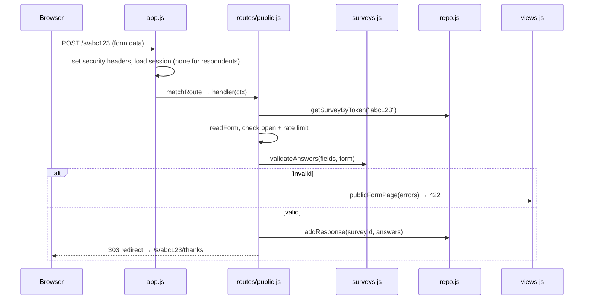
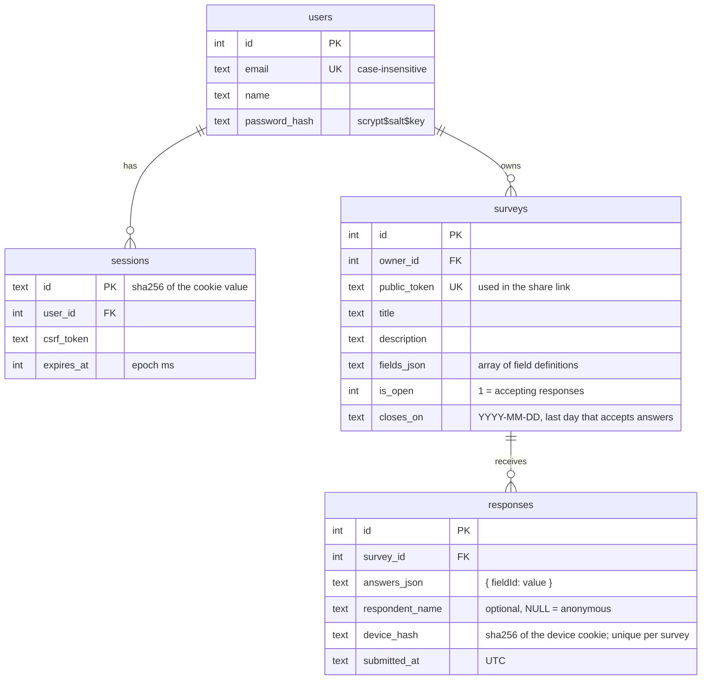

# Sharevy — Code Guide (`src/`)

A file-by-file tour of the server code: what each module does, what it exports, and why it is built that way.

> **TL;DR** — `server.js` boots the app. `app.js` turns every HTTP request into a `ctx` object and sends it to a route in `routes/`. Routes use `surveys.js` for business rules, `repo.js` for the database, and `views.js` for HTML. The only npm dependency is `qrcode` (pinned, used only by `qr.js`); everything else uses Node built-ins (`node:http`, `node:sqlite`, `node:crypto`).

---

## Table of contents

1. [Map of the code](#1-map-of-the-code)
2. [Life of a request](#2-life-of-a-request)
3. [Layers and dependency rules](#3-layers-and-dependency-rules)
4. [Data model](#4-data-model)
5. [File by file](#5-file-by-file)
   - [Bootstrap](#bootstrap) — `server.js`, `config.js`, `db.js`
   - [HTTP core](#http-core) — `app.js`, `http.js`, `guards.js`
   - [Routes](#routes) — `routes/auth.js`, `routes/surveys.js`, `routes/public.js`
   - [Domain](#domain) — `surveys.js`
   - [Infrastructure](#infrastructure) — `repo.js`, `auth.js`, `rate-limit.js`
   - [Presentation](#presentation) — `views.js`, `i18n.js`
6. [Common changes: where to touch](#6-common-changes-where-to-touch)

---

## 1. Map of the code

```
src/
├── server.js          Entry point: loads config, opens the DB, starts listening
├── config.js          Reads environment variables into one config object
├── db.js              Opens SQLite and creates the schema
├── app.js             HTTP server: router, sessions, static files, errors
├── http.js            Low-level HTTP helpers (cookies, forms, redirects)
├── guards.js          "Must be logged in" and CSRF wrappers for handlers
├── auth.js            Password hashing, tokens, session-id hashing
├── rate-limit.js      In-memory rate limiter + client IP detection
├── qr.js              QR code of the share link (SVG for the page, PNG download)
├── live.js            Live updates: in-process events streamed with Server-Sent Events
├── i18n.js            Interface languages: picks one per request, translates, formats dates
├── repo.js            All SQL queries (the only file that talks to the DB)
├── surveys.js         Business rules: survey definitions, answers, CSV
├── views.js           Server-rendered HTML pages
└── routes/
    ├── auth.js        Creator accounts: register, login, logout
    ├── surveys.js     Creator dashboard: CRUD, results, export
    └── public.js      Respondents: answer a survey through its link, and the language switch

locales/               en.json, es.json: every interface text, one file per language
```

| File | Lines (approx.) | Layer | One-line purpose |
|------|----:|-------|------------------|
| `server.js` | 20 | Bootstrap | Start the process |
| `config.js` | 25 | Bootstrap | Environment → config |
| `db.js` | 55 | Bootstrap | Schema + connection |
| `app.js` | 110 | HTTP core | Request pipeline |
| `http.js` | 65 | HTTP core | Request/response helpers |
| `guards.js` | 30 | HTTP core | Auth + CSRF wrappers |
| `routes/auth.js` | 100 | Routes | Account endpoints |
| `routes/surveys.js` | 100 | Routes | Creator endpoints |
| `routes/public.js` | 50 | Routes | Respondent endpoints |
| `surveys.js` | 200 | Domain | Validation, summary, CSV |
| `repo.js` | 100 | Infrastructure | SQL access |
| `auth.js` | 35 | Infrastructure | Crypto helpers |
| `rate-limit.js` | 60 | Infrastructure | Abuse protection |
| `qr.js` | 20 | Infrastructure | QR codes (wraps the `qrcode` package) |
| `live.js` | 45 | Infrastructure | Live updates (Server-Sent Events) |
| `views.js` | 270 | Presentation | HTML templates |
| `i18n.js` | 80 | Presentation | Translations (`locales/*.json`) and language choice |

---

## 2. Life of a request

Example: a respondent submits a survey (`POST /s/<token>`).



The same pipeline applies to every request:

| Step | Where | What happens |
|------|-------|--------------|
| 1 | `app.js` | Security headers are set on every response |
| 2 | `app.js` | `/public/*` and `/health` are answered directly, without session or routing |
| 3 | `app.js` → `loadSession` | `sid` cookie → hashed → session row → `ctx.user` |
| 4 | `app.js` → `matchRoute` | First route whose method + path match wins (404 / 405 otherwise) |
| 5 | `guards.js` | Creator routes are wrapped: redirect to login, CSRF check on POST |
| 6 | `routes/*.js` | Handler validates input (`surveys.js`), persists (`repo.js`), renders (`views.js`) |
| 7 | `app.js` `catch` | Any thrown `HttpError` becomes an HTML error page with its status; anything else is a logged 500 |

---

## 3. Layers and dependency rules

```
   routes/*  ──►  surveys.js (domain)      pure functions, no I/O
      │      ──►  repo.js    (database)    only place with SQL
      │      ──►  views.js   (HTML)        only place with markup
      │      ──►  guards.js / http.js / auth.js / rate-limit.js
      ▲
   app.js (wires everything, owns the request lifecycle)
      ▲
   server.js (process entry point)
```

| Rule | Why it matters |
|------|----------------|
| `surveys.js` has **no I/O** (no DB, no HTTP) | Business rules are unit-tested without a server (`test/surveys.test.js`) |
| SQL lives **only** in `repo.js` | Changing the storage engine touches one file |
| HTML lives **only** in `views.js` | Escaping is centralized: one `esc()` to audit |
| Routes receive dependencies (`{ route, repo, config, views }`) | Tests build the app with an in-memory DB and custom config |
| `createApp()` does not call `listen()` | Tests start it on a random port; `server.js` decides the real port |

---

## 4. Data model



**Why JSON columns for fields and answers?** Every survey has a different shape. Storing the definition (`fields_json`) and the answers keyed by field id (`answers_json`) avoids a dynamic schema, and keeps old answers readable after the survey is edited, because field ids are stable.

All foreign keys use `ON DELETE CASCADE`: deleting a survey deletes its responses; deleting a user deletes their sessions and surveys.

---

## 5. File by file

### Bootstrap

#### `server.js` — process entry point

**Purpose:** the only file with side effects at import time. Run with `npm start`.

| Does | Detail |
|------|--------|
| Loads config | `loadConfig()` from environment variables |
| Opens the database | `openDatabase(config.dbPath)` |
| Starts the HTTP server | `createApp({ db, config }).listen(port, host)` |
| Graceful shutdown | On `SIGINT` / `SIGTERM`: closes open connections, the server and the DB |

> Keep this file thin. Anything worth testing belongs in `app.js` or below.

---

#### `config.js` — configuration

**Exports:** `loadConfig(env = process.env)` → plain object.

| Key | Env var | Default | Used by |
|-----|---------|---------|---------|
| `port` | `PORT` | `3000` | `server.js` |
| `host` | `HOST` | `0.0.0.0` | `server.js` |
| `dbPath` | `DB_PATH` | `data/surveys.db` | `server.js`, `scripts/create-user.js` |
| `baseUrl` | `BASE_URL` | `''` (use `Host` header) | `routes/surveys.js` share link |
| `allowRegistration` | `ALLOW_REGISTRATION` | `true` | `routes/auth.js` |
| `cookieSecure` | `COOKIE_SECURE` | `false` | `routes/auth.js` |
| `sessionTtlMs` | — | 7 days | `routes/auth.js` |
| `trustProxy` | `TRUST_PROXY` | `false` | `rate-limit.js` → `clientIp` |
| `loginMaxFailures` | `LOGIN_MAX_FAILURES` | `10` | `routes/auth.js` |
| `loginWindowMs` | — | 15 min | `routes/auth.js` |
| `submissionLimit` | `SUBMISSION_LIMIT` | `60` (`0` = off) | `routes/public.js` |
| `submissionWindowMs` | — | 10 min | `routes/public.js` |
| `now` | — (tests only) | `() => new Date()` | `app.js` → `today()`, the clock used for closing dates |

**Design note:** it takes `env` as a parameter instead of reading `process.env` directly, so tests can call `loadConfig({})` and override single keys.

---

#### `db.js` — database connection and schema

**Exports:** `openDatabase(path)` → `DatabaseSync` instance.

| Step | Why |
|------|-----|
| Creates the parent folder | First run works without manual setup |
| `PRAGMA foreign_keys = ON` | SQLite disables FK enforcement by default; cascades need it |
| `PRAGMA journal_mode = WAL` | Readers do not block the writer |
| `PRAGMA busy_timeout = 5000` | Waits instead of failing if the DB is briefly locked |
| `CREATE TABLE IF NOT EXISTS …` | Idempotent schema: safe to run on every boot |

Pass `':memory:'` for a throwaway database (the tests do this).

**Migrations:** after the base schema, `migrate()` runs the `MIGRATIONS` list inside one transaction. Each step checks the current shape first (for example `hasColumn`) and only then alters the table, so steps are idempotent and run on every boot. Add new steps at the end of the list; never edit a released step.


---

### HTTP core

#### `app.js` — the request pipeline

**Exports:** `createApp({ db, config })` → a `node:http` `Server` (not listening yet).

**What it builds once, at startup:**

| Piece | Detail |
|-------|--------|
| `repo` | `createRepo(db)` |
| Static assets | Reads `public/style.css`, `app.js`, `builder.js`, `theme.js`, `favicon.svg`, `logo.png` and the three `fonts/*.woff2` files into memory. Only these names are served; there is no directory listing or path traversal surface |
| Asset versions | Hashes each asset (SHA-256, 10 chars) and hands the map to `views.setAssetVersions`. Pages link `/public/style.css?v=<hash>`, which is served with `immutable` caching; when a file changes its URL changes, so browsers never keep a stale stylesheet. Fonts (`font/woff2`) are linked from `style.css` without `?v` and are always `immutable`: a new font version gets a new file name |
| Routes table | Each `route(method, '/path/:param', handler)` compiles to a regex; `:param` matches one path segment |

**Per request:**

| Function | Responsibility |
|----------|----------------|
| Security headers | Strict `Content-Security-Policy` (no inline scripts), `X-Frame-Options: DENY`, `nosniff`, `no-referrer` |
| Language | `ctx.i18n = createI18n(negotiateLanguage(cookie sharevy_lang, Accept-Language))`, before routing, so error pages are translated too |
| `loadSession(ctx)` | Cookie `sid` → `hashSessionId` → `repo.getSession` → `ctx.session`, `ctx.user` |
| `matchRoute(method, path)` | Returns the handler and decoded params. Returns 405 if the path exists with another method, 404 if it does not exist, 400 for a malformed `%` encoding |
| Error boundary | `HttpError` → page with that status, its message translated with `ctx.i18n`. Unknown error → logged + generic 500 (no stack traces to users). Respondent pages (`/s/...`) render without creator navigation |

**The `ctx` object** passed to every handler:

```js
{ req, res, url, params, user, session, i18n }
// i18n    → { lang, t, tn, formatDate } for the request's language (see i18n.js)
// user    → { id, name, email } | null
// session → { id, user_id, csrf_token, expires_at } | null
```

Routes also receive `ui(ctx)` in their dependencies: `{ i18n, currentPath }`, the two things every page needs (its language, and its own URL for the language switch). Pass it to every view: `views.homePage({ ...ui(ctx), ... })`.

> **Order matters:** routes are matched in registration order. `/surveys/new` is registered before `/surveys/:id`, otherwise `new` would be captured as an id.

---

#### `http.js` — low-level helpers

| Export | What it does |
|--------|--------------|
| `HttpError(status, key, params)` | Throwable error carrying an HTTP status and a translation key (e.g. `'error.surveyNotFound'`); `app.js` renders it in the request's language. `err.message` holds the English text for logs |
| `parseCookies(header)` | `"a=1; b=2"` → `{ a: '1', b: '2' }`, tolerant of bad encoding |
| `readForm(req, limit = 1 MB)` | Reads a `application/x-www-form-urlencoded` body and returns `URLSearchParams`. 415 for other content types, 413 if over the limit |
| `sendHtml(res, status, html)` | Writes HTML with `Cache-Control: no-store` |
| `redirect(res, location, headers)` | `303 See Other`, so the browser does a GET after a POST (no "resend form?" prompts) |
| `safeNext(value, fallback)` | Validates a redirect target from the URL: after login, and after switching language (see below) |

**`safeNext` in detail** — prevents open redirects (`/login?next=https://evil.com`):

1. It must start with `/` and not with `//`.
2. It must not contain control characters, spaces or `\`. Browsers silently strip tabs and newlines, so `/\t/evil.com` would become `//evil.com`.
3. It is parsed with `new URL()`, and the origin must stay the same.
4. Anything else falls back to `/surveys` (or the `fallback` given; the language switch uses `/`).

`readForm` returns `URLSearchParams` on purpose: `getAll(name)` handles multi-value fields (checkboxes) without a custom parser.

---

#### `guards.js` — handler wrappers

| Export | Use it for | Behavior |
|--------|-----------|----------|
| `authed(handler)` | Creator **GET** routes | No user → `303 /login?next=<current path>` |
| `authedPost(handler)` | Creator **POST** routes | No user → redirect; reads the form; checks CSRF; calls `handler(ctx, form)` |
| `checkCsrf(ctx, form)` | Manual check (used by logout) | Compares `_csrf` with `session.csrf_token` in constant time; mismatch → 403 |

```js
route('POST', '/surveys/:id/delete', authedPost((ctx, form) => { /* ctx.user is guaranteed */ }));
```

**Why CSRF tokens if cookies are `SameSite=Lax`?** Defense in depth: `Lax` blocks most cross-site POSTs, but tokens also protect older browsers and same-site attackers (another app on the same intranet domain).

---

### Routes

Every route file exports `register*Routes({ route, repo, config, views })` and only registers handlers. Nothing runs at import time.

#### `routes/auth.js` — creator accounts

| Method | Path | Guard | Result |
|--------|------|-------|--------|
| GET | `/` | — | Logged in → `/surveys`; otherwise the landing page |
| GET | `/login` | — | Login form (`next` is sanitized) |
| POST | `/login` | rate limit | 303 to `next` · 401 bad credentials · 429 too many failures |
| GET | `/register` | `allowRegistration` | Form, or 404 when registration is disabled |
| POST | `/register` | `allowRegistration` | 303 `/surveys` · 422 with validation errors |
| POST | `/logout` | CSRF (if logged in) | Deletes the session, clears the cookie |

**Key internals:**

- **`startSession`** — deletes any previous session (prevents session fixation), purges expired ones, creates a random 32-byte id, stores **its hash**, and sends the raw id in an `HttpOnly; SameSite=Lax` cookie (`Secure` when `COOKIE_SECURE=true`).
- **Login timing** — when the email does not exist, the password is still checked against `DUMMY_HASH`, so response time does not reveal which emails are registered.
- **Brute-force limiter** — keyed by `email|ip`. After `loginMaxFailures` failures in 15 minutes it answers 429 with `Retry-After`. A successful login resets the counter. Keying by email **and** IP means an attacker on another machine cannot lock a colleague out.
- **Registration rules** — name 1–100 characters, valid email up to 254, password 8–200 characters, confirmation must match, email unique (case-insensitive).

---

#### `routes/surveys.js` — creator dashboard

All routes are wrapped in `authed` / `authedPost`.

| Method | Path | Result |
|--------|------|--------|
| GET | `/surveys` | List of the creator's surveys with response counts |
| GET | `/surveys/events` | Live stream (SSE) for the creator's list; registered before `/surveys/:id` |
| GET | `/surveys/:id/events` | Live stream (SSE) for one survey's results |
| GET | `/surveys/new` | Empty editor |
| POST | `/surveys` | Create → 303 `/surveys/:id` · 422 re-renders the editor with errors |
| GET | `/surveys/:id` | Detail: share link, actions, summary, responses table |
| GET | `/surveys/:id/edit` | Editor pre-filled with the current fields |
| POST | `/surveys/:id` | Save edits (field ids are preserved) |
| POST | `/surveys/:id/toggle` | Open ↔ closed |
| POST | `/surveys/:id/delete` | Delete the survey and all its responses |
| POST | `/surveys/:id/responses/:responseId/delete` | Delete one response |
| GET | `/surveys/:id/export.csv[?delimiter=semicolon]` | Download CSV (UTF-8 with BOM) |
| GET | `/surveys/:id/qr.png` | Download the QR code of the share link (600px PNG) |

**Key internals:**

- **`ownedSurvey(ctx)`** — the single ownership gate. It loads the survey by id **and** `owner_id = ctx.user.id`; otherwise it throws 404. Returning 404 instead of 403 means another creator cannot even tell that the survey exists.
- **`shareUrl(ctx, survey)`** — `BASE_URL` + `/s/<publicToken>`, or the request's `Host` header when `BASE_URL` is unset.
- **Public token** — `newToken(18)` gives 144 random bits, so links cannot be guessed or enumerated.
- **CSV BOM** — the `` prefix makes Excel read accented characters correctly. The `;` variant exists for Excel with Spanish/European regional settings.

---

#### `routes/public.js` — respondents (no account)

| Method | Path | Result |
|--------|------|--------|
| GET | `/s/:token` | The form, or a "closed" page |
| POST | `/s/:token` | 303 `/thanks` · 422 with per-field errors and the values kept · 403 closed · 429 rate limited |
| GET | `/s/:token/thanks` | Confirmation page |
| GET | `/lang/:code?next=<path>` | Language menu links, for everyone: 303 to `safeNext(next, '/')` with a `sharevy_lang` cookie (HttpOnly, SameSite=Lax, 1 year). 404 for an unsupported code |

**Order of checks on submit** (cheapest and most decisive first):

1. Survey exists? Otherwise 404.
2. Survey open? Otherwise 403.
3. Under the rate limit for `surveyId|ip`? Otherwise 429.
4. Answers valid (`validateAnswers`)? Otherwise 422, re-rendered with the values the person typed.
5. Count the submission against the limit, store it, redirect.

**One response per device:** the first accepted submission sets an HttpOnly `sharevy_device` cookie (random id, 400 days). Its hash is stored in `responses.device_hash`, and a unique index on `(survey_id, device_hash)` makes the database reject a second response, even when two submissions race. A device that already answered sees `alreadyAnsweredPage` (200 on GET, 409 on POST). Clearing cookies, private mode or another browser count as a new device: this stops accidental and casual duplicates, not determined abuse.

No CSRF token here, on purpose: respondents are anonymous and have no session to protect. Invalid submissions do not count toward the rate limit.

---

### Domain

#### `surveys.js` — business rules (pure functions)

The heart of the app. It has no database, no HTTP and no HTML, which is why it can be unit-tested in isolation.

**Constants**

| Export | Content |
|--------|---------|
| `FIELD_TYPES` | `text`, `textarea`, `number`, `email`, `date`, `select`, `radio`, `yesno`, `checkbox` → English display label |
| `fieldTypeLabels(t)` | The same map with labels in the translator's language (used by the editor) |
| `CHOICE_TYPES` | `select`, `radio`, `checkbox` (the types whose options the creator writes) |
| `YES_NO` | `['yes', 'no']`: the fixed, language-independent values stored for a `yesno` question |
| `LIMITS` | Maximum lengths and counts (title 200, 100 fields, 100 options, text answers 1 000, long text 10 000…) |

**Field definition** (one item of `fields_json`):

```js
{ id: 'a1b2c3d4e5f6', label: 'Department', type: 'select', required: true, options: ['IT', 'HR'] }
```

**Messages:** validation messages come from a translator passed in the options argument (`{ t }`), English by default. Routes pass `ctx.i18n.t`; unit tests can omit it. The only import besides `node:crypto` is `i18n.js`, for that English default.

**Functions**

| Function | Input → Output | Notes |
|----------|----------------|-------|
| `parseSurveyInput({ title, description, fieldsJson, closesOn }, { today, currentClosesOn, t })` | → `{ value, errors[] }` | Empty `closesOn` defaults to `today` + `DEFAULT_OPEN_DAYS` (10). A past date is rejected unless it is the survey's current date (editing an expired survey). Also trims, enforces limits and ignores blank options. **Rejects repeated options in one question and two questions with the same text** (equal after trimming, ignoring case): multiple-choice answers are stored by option text, so repeats could not be told apart. **Keeps a valid existing `id`** so edits do not orphan answers; generates a new one when it is missing, invalid or duplicated |
| `validateAnswers(fields, form, { t })` | → `{ answers, errors{fieldId: msg} }` | Reads only defined fields (`f_<id>`), so extra keys are ignored. Checks type, required, and that choices are among the options. Checkbox values are returned in option order |
| `surveyStatus(survey, today)` | → `'open' | 'closed' | 'expired'` | `closed` = switched off by the creator; `expired` = `today` is after `closesOn`. Only `open` accepts answers |
| `localDateString(date)`, `addDays(date, n)` | → `YYYY-MM-DD` | Server-local calendar date; calendar math without time zones |
| `daysBetween(from, to)` | → whole days | Days from one `YYYY-MM-DD` to another; the "days left" figure on the results page |
| `parseRespondentName(value, { t })` | → `{ name, error }` | Optional respondent name: trimmed, max. 100 characters, empty means anonymous |
| `formatAnswer(value)` | → `string` | Arrays become `"a, b"` |
| `answerText(field, value, t)` | → `string` | What the results table and CSV show: `yes`/`no` translated (`answer.yes`, `answer.no`), anything else through `formatAnswer` |
| `fieldOptions(field)` | → `string[]` | Accepted values of a choice question: `YES_NO` for `yesno`, otherwise the creator's options |
| `summarize(fields, responses, { t })` | → per choice field (yes/no included): `answered`, counts per option (`option` stored value, `label` text to show) | Feeds the summary section of the detail page |
| `csvCell(value, delimiter)` | → escaped cell | Quotes when needed. Prefixes `'` to values starting with `= + - @` (formula injection), except plain numbers like `-5` |
| `toCsv(fields, responses, delimiter, { t })` | → full CSV text | Header (fixed columns in the translator's language) + rows in submission order (yes/no answers translated), `\r\n` line endings |

**Validation per type**

| Type | Accepted value |
|------|----------------|
| `text` | Up to 1 000 characters |
| `textarea` | Up to 10 000 characters |
| `number` | Anything `Number()` parses as finite. In the browser, `public/app.js` also blocks typing or pasting anything else (see below) |
| `email` | `x@y.z` shape, up to 254 characters |
| `date` | `YYYY-MM-DD` that is a real calendar date (`2026-02-30` is rejected) |
| `select`, `radio` | Exactly one of the options |
| `yesno` | `yes` or `no` (the creator writes no options; the form shows them translated) |
| `checkbox` | Any subset of the options; `required` means at least one |

---

### Infrastructure

#### `repo.js` — data access

**Exports:** `createRepo(db)` → object with one method per query. It is the **only** file that contains SQL.

| Group | Methods |
|-------|---------|
| Users | `createUser`, `findUserByEmail`, `findUserById` |
| Sessions | `createSession`, `getSession` (ignores expired ones), `deleteSession`, `deleteExpiredSessions` |
| Surveys | `listSurveys(ownerId)`, `createSurvey`, `getOwnedSurvey(id, ownerId)`, `getSurveyByToken`, `updateSurvey`, `setSurveyOpen`, `deleteSurvey` |
| Responses | `addResponse` (returns `null` when the device already answered), `hasDeviceResponse`, `listResponses` (newest first), `deleteResponse(surveyId, responseId)` |

**Design notes:**

- Every write on a survey filters by `owner_id`, and `deleteResponse` filters by `survey_id`. Ownership is enforced **in SQL too**, not only in the route.
- Only positional `?` parameters are used, never string interpolation, so SQL injection is not possible.
- `hydrateSurvey` / `hydrateResponse` convert rows (snake_case, JSON strings, `0/1`) into app objects (camelCase, parsed JSON, booleans). The rest of the code never sees raw rows, except `ctx.session`.

---

#### `auth.js` — crypto helpers

| Export | What it does |
|--------|--------------|
| `newToken(bytes = 32)` | Random URL-safe token (session ids, CSRF tokens, survey links) |
| `hashPassword(pw)` | scrypt with a random 16-byte salt → `"scrypt$<salt>$<key>"` |
| `verifyPassword(pw, stored)` | Recomputes and compares in constant time; `false` for malformed hashes |
| `hashToken(token)` / `hashSessionId(id)` | SHA-256 of a cookie value (sessions and respondent devices). A leaked DB does not give usable cookies |
| `safeEqual(a, b)` | Constant-time string comparison (used for CSRF) |
| `DUMMY_HASH` | Precomputed hash for the "unknown email" login path |

**Why scrypt?** It is built into Node (no native dependency to compile on Windows) and is memory-hard, which makes GPU brute force expensive. The `scrypt$` prefix leaves room to switch algorithms later.

---

#### `rate-limit.js` — abuse protection

| Export | What it does |
|--------|--------------|
| `createRateLimiter({ limit, windowMs, now?, maxKeys? })` | Fixed-window counter per key: `isLimited`, `hit`, `reset`, `retryAfterSeconds`. `limit: 0` disables it |
| `clientIp(req, trustProxy)` | Socket address, or the first `X-Forwarded-For` entry **only** when `TRUST_PROXY=true` |

**Trade-offs (deliberate):**

| Choice | Consequence |
|--------|-------------|
| In memory | Zero setup; counters reset when the process restarts and are not shared between processes |
| Fixed window | Simple and predictable; allows a short burst at window edges |
| `maxKeys` cap (10 000) | Memory stays bounded: expired keys are pruned first, then the oldest |
| `now` injectable | Tests control time without waiting |
| `X-Forwarded-For` opt-in | Otherwise any client could fake its IP to dodge the limit |

---

#### `live.js` — live updates

**Exports:** `createLiveUpdates()` → `{ surveyChanged(survey), stream(req, res, channel) }`. `app.js` creates one instance and passes it to the routes as `live`.

| Piece | Detail |
|-------|--------|
| Channels | `survey:<id>` (results page) and `owner:<userId>` (survey list) |
| Publishers | A new response (`routes/public.js`), and creating, editing, opening/closing, deleting a survey or a response (`routes/surveys.js`) |
| `stream()` | Writes an `text/event-stream` response: `: connected` on open, `event: change` per change, `: ping` every 25 s, cleanup on disconnect |
| Browser side | `public/app.js` opens an `EventSource` for each `[data-live][id]` element. On `change` it re-fetches the current page and swaps that element's HTML; after a reconnection it refreshes once, in case events were missed |

**Why events carry no data:** the page re-renders through the same server code as a manual refresh, so a live update can never show something different from a reload. **Limits:** events live in memory in one process; running several server processes would need a shared bus (for example Redis pub/sub).

#### `qr.js` — QR codes

| Export | What it does |
|--------|--------------|
| `qrSvg(text, label)` | Inline SVG for the survey page, with `role="img"` and an accessible name |
| `qrPng(text)` | 600px PNG buffer for the download route, large enough to print |

Both use medium error correction and a 2-module margin. The SVG is embedded without escaping because the library only emits numeric path data, never the encoded text. The QR always encodes the same URL as the share link (`BASE_URL` or the request host), so set `BASE_URL` when the app sits behind a proxy, or the code will point to the wrong address. Only `qr.js` imports `qrcode`, so replacing the library touches one file.

---

### Presentation

#### `views.js` — HTML pages

Server-rendered template strings. Every page is plain HTML forms, so it works without JavaScript, except the question builder (`public/builder.js`).

**Every view takes `i18n` and `currentPath`** (from `ui(ctx)`) and gets all its text from `i18n.t(key)`; without them it renders English. Text that must contain markup (a link or `<strong>` inside a sentence) uses `tHtml(i18n, key, { name: markup })`: the translation is escaped first, then each `{name}` is replaced by markup built in `views.js`.

**Safety first:** `esc(value)` escapes `& < > " '`. **Every** user-controlled value goes through it, in text and in attributes. When adding a view, never interpolate raw data.

| Export | Page | Notes |
|--------|------|-------|
| `homePage` | Landing | Login / register buttons |
| `loginPage`, `registerPage` | Account forms | Keep typed values on error (never the password) |
| `surveyListPage` | "My surveys" | Status badge + response count |
| `surveyEditorPage` | New/edit | Hidden `fields_json` + `#builder` container; warns when editing a survey with responses. `public/builder.js` shows repeated questions and options as inline messages while the creator types and blocks submitting until they are fixed. On submit it also checks title, closing date, question text and options (server messages, inline, no reload); the form carries `data-limits` |
| `surveyDetailPage` | Results | Share link with copy button, open/close/delete actions, CSV links, key figures, charts, responses table |
| `publicFormPage` | Respondent form | `renderField` per type (`yesno`: two large side-by-side radios, `.choices.yesno`); per-field errors; values kept after an error |
| `thanksPage`, `closedPage` | Respondent states | |
| `errorPage` | Any error | `respondent: true` hides creator navigation |

**Branding and icons:** `APP_NAME` (`Sharevy`) is used for the header and every `<title>` (`<page> · Sharevy`). The header shows `public/logo.png` (white clipboard, 128px, decorative `alt=""`) left of the name; it is a cropped copy of `assets/logo-source.png`. The favicon (`public/favicon.svg`) draws the same clipboard on a square slate background (`#1e2a3a`, the top bar color) so it stays visible on light browser tabs. `icon(name)` returns an inline SVG from the `ICONS` map; icon-only buttons always carry an `aria-label` and a `title` so they stay understandable.

**Confirmation messages:** creator actions redirect with `?msg=<key>` (`created`, `saved`, `closed`, `opened`, `deleted`, `response-deleted`). `flashMessage(key, i18n)` maps only known keys to fixed, translated text; the query value is never reflected into the page.

**Design tokens (corporate look):** every color, the font and the corner radius are custom properties at the top of `public/style.css`. Change them there, never in individual rules.

| Token | Light | Dark | Used for |
|-------|-------|------|----------|
| `--topbar` | `#1e2a3a` | `#1b2633` | Top bar (the white `logo.png` sits on it) |
| `--brand` / `--brand-dark` | `#2b4a6f` / `#1f3753` | `#3a5f8a` / `#2f5079` | Primary buttons / their hover; white text on top |
| `--brand-text` | `#2b4a6f` | `#9fbbdc` | Links, brand-colored text, focus rings |
| `--brand-soft` | `#e6ecf3` | `#22303f` | Hover and selected tint |
| `--text` / `--muted` | `#1c232c` / `#56606c` | `#e4e8ee` / `#a0aab6` | Body text / secondary text |
| `--bg` / `--surface` / `--surface-alt` | `#f3f4f6` / `#fff` / `#f7f8fa` | `#12171e` / `#1a212b` / `#161c24` | Page / panels / table headers and the respondent-name box |
| `--border` / `--border-strong` | `#d5dae1` / `#7d8794` | `#2f3946` / `#6b7685` | Panel and table rules / form controls (>= 3:1) |
| `--ok`, `--warn`, `--danger`, `--closed` (+ `-soft`) | muted green, ochre, brick, grey | lighter tints of the same | Status text on its tinted box (>= 4.5:1) |
| `--radius` | `0` | `0` | Square corners everywhere; only radio buttons and donut charts stay round |
| `--font` | `"IBM Plex Sans", "Segoe UI", system-ui, sans-serif` | same | All text |

| Rule | Detail |
|------|--------|
| Typography | IBM Plex Sans 400/500/600 from `public/fonts/` (`@font-face` at the top of `style.css`, 400 preloaded in `layout()`). Section headings (`h2`, `h3`, KPI and table headers) are small uppercase labels with letter spacing |
| Lines | 1px rules, a 3px accent on the top or left edge of key boxes (survey intro, KPIs, cards, messages), almost no shadows, no dashed borders |
| Contrast | Every text pair meets WCAG AA (>= 4.5:1) in both themes; recheck any new color |

**To change the brand color:** edit `--brand`, `--brand-dark`, `--brand-text`, `--brand-soft` and `--topbar` in the three palette blocks of `style.css` (light, `[data-theme="dark"]`, `prefers-color-scheme: dark`; keep the two dark blocks identical), then update `<meta name="theme-color">` in `layout()` and the `fill` of `public/favicon.svg`. Check white text on `--brand` and `--brand-text` on `--surface` still reach 4.5:1.

**Light and dark theme:** every page has a theme button (`themeToggle()`, rendered `hidden` until `public/app.js` activates it). The choice is stored in `localStorage` (`sharevy-theme`); without a choice, the OS setting (`prefers-color-scheme`) decides. `public/theme.js` is loaded in `<head>` so a saved choice applies before the first paint (no flash of the wrong theme). Colors are CSS custom properties in `style.css`; the dark palette redefines them under `[data-theme="dark"]` and in the `prefers-color-scheme: dark` media query. Use `--brand-text` for brand-colored text and `--brand` for brand backgrounds.

**Language menu:** next to the theme button, `languageMenu()` renders a native `<details class="lang-menu">`: the summary shows a globe and the current code (`EN`), the list has one link per `SUPPORTED_LANGUAGES` entry, named in its own language (`language.name`: "English", "Español") and pointing to `/lang/<code>?next=<current page>`; the current one has `aria-current="true"`. It works without JavaScript; `public/app.js` only closes it on an outside click or Escape. On phones the panel opens under the whole top bar so it is never cut off. Strings that the browser scripts need (keys starting with `client.`) travel in `<script type="application/json" id="i18n-client">` in `<head>`: a data block, never executed, so the CSP allows it; `<` is written as `\u003c` so the JSON cannot close the tag. `public/app.js` and `public/builder.js` read it.

**Mobile first:** `public/style.css` targets phones by default (44px touch targets, 16px+ inputs, full-width buttons) and enhances layouts from 700px. On phones, the responses table turns into one card per response using each cell's `data-label`.

**Desktop (≥ 1100px):** detected with CSS media queries only (no user-agent checks). The container grows to 1280px and pages get two columns; the HTML order stays the phone order, CSS grid only places the blocks.

| Page | Main column | Side column |
|------|-------------|-------------|
| Survey detail | `.detail-main` → `#responses`: key figures, charts, table | `.detail-side`: share link, QR, manage (sticky, scrolls on its own if taller than the window) |
| Editor | `.editor-questions` | `.editor-basics`, then the save buttons (sticky) |
| My surveys | Cards in 3–4 columns | — |

The respondent form stays narrow (720px) on purpose: short lines are easier to read.

**Charts (results page):** `summaryHtml()` draws one card per choice question, as server-rendered SVG inside `#responses`, so live updates redraw them.

| Question type | Chart | Why |
|---------------|-------|-----|
| `radio`, `select` (up to 6 options), `yesno` | Donut (`donutChart`) + legend with count and % | One answer per person: the shares add up to 100% |
| `checkbox` | Horizontal bars (`barChart`) + a note | Several answers per person: the % add up to more than 100%, so a pie would mislead |
| `radio`, `select` with more than 6 options | Bars | Categorical colors are never repeated |

The SVG is `aria-hidden`; the legend and bar labels carry every number as text. Colors come from classes (`.slice-1`…`.slice-6` → `--cat-1`…`--cat-6`, `--bar-fill`), defined for light and dark in `style.css` from a muted palette checked with a colorblind validator (lightness band, chroma floor, CVD separation, >= 3:1 against the panel), so no inline `style` is needed. Bars and swatches are square like the rest of the interface. `kpiTiles()` renders the key figures as a `<dl class="kpis">` above the charts.

**Internal helpers:** `layout()` (shared shell; `respondent: true` gives a minimal header), `errorList()`, `csrfInput()`, `renderField()` (maps each field type to its HTML control, uses `required` for native browser validation; the server is still the source of truth), and `summaryHtml()` / `donutChart()` / `barChart()` / `kpiTiles()`.

**Animations:** CSS only, in the "Motion" section at the end of `public/style.css`. Short fades and small slides (150–250 ms, one standard easing `--ease`); no spins, bounces or overshoot. Rules that keep them cheap and calm:

| Rule | Detail |
|------|--------|
| Only `transform` and `opacity` | Plus `stroke-dashoffset` for the thanks check mark; nothing that forces a re-layout. No JS animation loops, no library |
| Page changes | `@view-transition { navigation: auto; }` cross-fades pages where supported; the top bar keeps its own `view-transition-name` |
| Live updates | `.live-updated *` turns entrance animations off, so a swapped section only gets the highlight ring |
| Theme switch | Short color fade on the main surfaces only (`body`, top bar, panels, cards, inputs), never on `*` |
| Reduced motion | `prefers-reduced-motion: reduce` sets every animation and transition to ~0 and disables view transitions |

**Respondent form in the browser (`public/app.js`):**

| Behavior | Detail |
|----------|--------|
| Checks before sending | On submit (button or Enter) the answers are checked with the same rules and messages as `validateAnswers` / `parseRespondentName`. Invalid → nothing is sent, no reload; errors appear with the server's markup (`.has-error`, `.field-error`, `aria-invalid` / `aria-describedby`, the `.errors` summary with links) and the first invalid question gets the focus. A question's error clears as soon as its answer is valid. The script sets `noValidate`; the HTML keeps `required` for browsers without JavaScript, and the server always checks again |
| Where the rules come from | `renderField` puts `data-type`, `data-required` and `data-label` on each `.field`; the form carries `data-limits` (`LIMITS` as JSON); messages come from the `i18n-client` block. Changing a rule means changing `src/surveys.js` **and** `check()` in `public/app.js` |
| Number questions | Only digits, one decimal point and a leading `-` can be typed, pasted or dropped (`beforeinput`, with an `input` safety net). A comma becomes a point (`4,5` → `4.5`). The script turns the field into a text input with `inputmode="decimal"` (number keyboard on phones), because a native number input hides the typed text and cursor from scripts; Up/Down arrows still add or subtract 1. Without JavaScript it stays `type="number"` |

**No inline JS or CSS:** the CSP forbids it, so behaviors like "copy link" or "confirm delete" are declared with `data-copy` / `data-confirm` attributes and handled by `public/app.js`.

---

#### `i18n.js` — interface languages

All interface text lives in `locales/<code>.json`, one flat file per language, read once at startup.

| Export | What it does |
|--------|--------------|
| `SUPPORTED_LANGUAGES`, `DEFAULT_LANGUAGE` | `['en', 'es']`, `'en'` |
| `LANGUAGE_COOKIE` | `sharevy_lang`, set by `GET /lang/:code` |
| `negotiateLanguage(cookie, acceptLanguage)` | A supported cookie wins; otherwise the first supported language of `Accept-Language` by q-value (`es-MX` → `es`); `*`, nothing or only unsupported languages → `en` |
| `createI18n(lang)` | `{ lang, t(key, params), tn(key, count, params), formatDate(yyyyMmDd) }` |
| `clientMessages(i18n)` | The `client.*` strings (prefix removed) plus the server messages the browser also shows (`validation.*`, `respond.checkAnswers.*`, `respond.yourName`, full names), for the browser scripts |
| `defaultI18n` | English translator, the default wherever no request is involved |

**Locale file format**

```json
{
  "list.responses.one": "{count} response",
  "list.responses.other": "{count} responses",
  "validation.titleTooLong": "Title must be at most {max} characters."
}
```

| Rule | Detail |
|------|--------|
| Keys | Flat, dot-separated, grouped by page (`nav.`, `detail.`, `respond.`, `validation.`, `client.`…) |
| Placeholders | `{name}`, filled by `t(key, { name })`. Unknown placeholders are left as they are |
| Plurals | `<key>.one` / `<key>.other`, chosen by `tn(key, count)` with `Intl.PluralRules`; `{count}` is available |
| Missing key | Falls back to English, then to the key itself |
| Dates | `formatDate` uses `Intl` (UTC): `Nov 26, 2026` in English, `26 nov 2026` in Spanish |

`test/i18n.test.js` checks that every locale file has exactly the keys of `en.json` and keeps every `{placeholder}`.

**How to add a language** (e.g. Portuguese)

1. Copy `locales/en.json` to `locales/pt.json` and translate the values (keep keys and `{placeholders}`).
2. Add `'pt'` to `SUPPORTED_LANGUAGES` and a date locale (`pt: 'pt-BR'`) to `DATE_LOCALES` in `i18n.js`.
3. Run `npm test`. The language menu lists the new language automatically, under its own `language.name` ("Português").

---

## 6. Common changes: where to touch

| I want to… | Files |
|------------|-------|
| **Add a field type** (e.g. `phone`) | `surveys.js` (`FIELD_TYPE_IDS` + a `validateAnswers` case) → a `fieldType.<id>` label in every `locales/*.json` → `views.js` (`renderField` / `INPUT_TYPES`) → `test/surveys.test.js`. The builder picks it up automatically from `FIELD_TYPES` |
| **Add a page or endpoint** | The matching `routes/*.js` + a function in `views.js` (pass `...ui(ctx)`; new text goes in every `locales/*.json`) (+ a `repo.js` method if it needs data) + `test/app.test.js` |
| **Add a column** | `db.js` (schema + an `ALTER TABLE` for existing databases) → `repo.js` (query + hydrate) |
| **Add a setting** | `config.js` → the consumer → the README configuration table |
| **Change limits** | `LIMITS` in `surveys.js` (survey content) or `config.js` (rate limits) |
| **Add an icon** | Add its path to `ICONS` in `views.js` (and in `public/builder.js` if the builder uses it) |
| **Change or translate a text** | Edit the key in `locales/en.json` and `locales/es.json`. Browser-script text uses `client.*` keys |
| **Add a language** | A new `locales/<code>.json` + `SUPPORTED_LANGUAGES` and `DATE_LOCALES` in `i18n.js` (see [`i18n.js`](#i18njs--interface-languages)) |

**Checklist before committing**

- [ ] `npm test` is green
- [ ] Every new HTML interpolation uses `esc()`
- [ ] Every new interface text is a key in every `locales/*.json` (`test/i18n.test.js` checks it)
- [ ] Every new creator route uses `authed` / `authedPost` and `ownedSurvey`
- [ ] New SQL lives in `repo.js` and uses `?` parameters
- [ ] No inline `<script>` or `style=""` (the CSP would block it)
