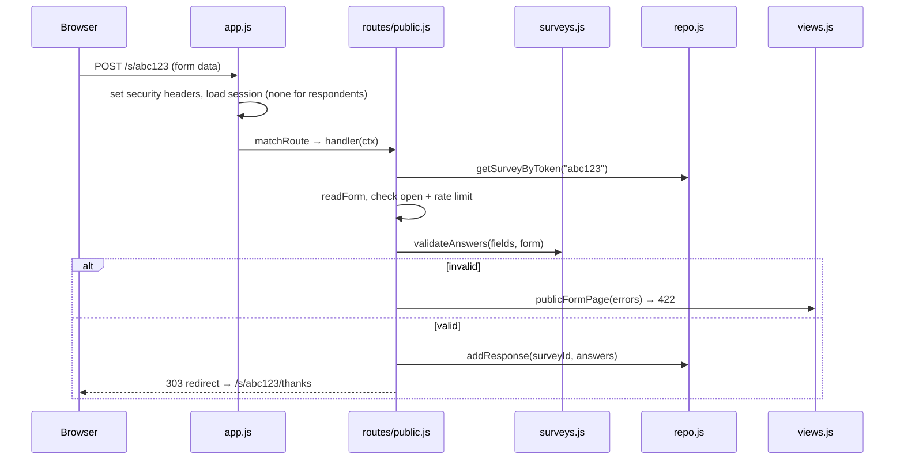
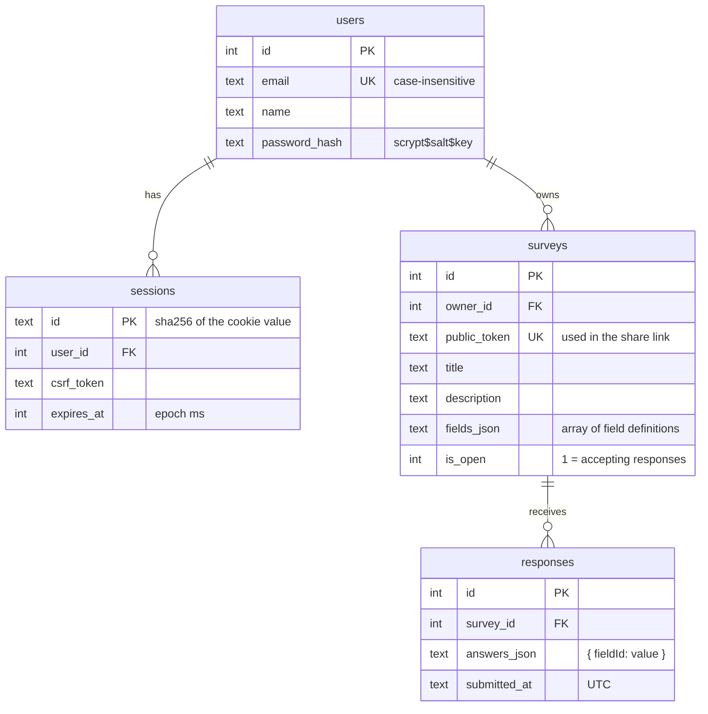

# Code Guide — `src/`

A file-by-file tour of the server code: what each module does, what it exports, and why it is built that way.

> **TL;DR** — `server.js` boots the app. `app.js` turns every HTTP request into a `ctx` object and sends it to a route in `routes/`. Routes use `surveys.js` for business rules, `repo.js` for the database, and `views.js` for HTML. There are **zero npm dependencies**: everything uses Node built-ins (`node:http`, `node:sqlite`, `node:crypto`).

---

## Table of contents

1. [Map of the code](#1-map-of-the-code)
2. [Life of a request](#2-life-of-a-request)
3. [Layers and dependency rules](#3-layers-and-dependency-rules)
4. [Data model](#4-data-model)
5. [File by file](#5-file-by-file)
   - [Bootstrap](#bootstrap) — `server.js`, `config.js`, `db.js`
   - [HTTP core](#http-core) — `app.js`, `http.js`, `guards.js`
   - [Routes](#routes) — `routes/auth.js`, `routes/surveys.js`, `routes/public.js`
   - [Domain](#domain) — `surveys.js`
   - [Infrastructure](#infrastructure) — `repo.js`, `auth.js`, `rate-limit.js`
   - [Presentation](#presentation) — `views.js`
6. [Common changes: where to touch](#6-common-changes-where-to-touch)

---

## 1. Map of the code

```
src/
├── server.js          Entry point: loads config, opens the DB, starts listening
├── config.js          Reads environment variables into one config object
├── db.js              Opens SQLite and creates the schema
├── app.js             HTTP server: router, sessions, static files, errors
├── http.js            Low-level HTTP helpers (cookies, forms, redirects)
├── guards.js          "Must be logged in" and CSRF wrappers for handlers
├── auth.js            Password hashing, tokens, session-id hashing
├── rate-limit.js      In-memory rate limiter + client IP detection
├── repo.js            All SQL queries (the only file that talks to the DB)
├── surveys.js         Business rules: survey definitions, answers, CSV
├── views.js           Server-rendered HTML pages
└── routes/
    ├── auth.js        Creator accounts: register, login, logout
    ├── surveys.js     Creator dashboard: CRUD, results, export
    └── public.js      Respondents: answer a survey through its link
```

| File | Lines (approx.) | Layer | One-line purpose |
|------|----:|-------|------------------|
| `server.js` | 20 | Bootstrap | Start the process |
| `config.js` | 25 | Bootstrap | Environment → config |
| `db.js` | 55 | Bootstrap | Schema + connection |
| `app.js` | 110 | HTTP core | Request pipeline |
| `http.js` | 65 | HTTP core | Request/response helpers |
| `guards.js` | 30 | HTTP core | Auth + CSRF wrappers |
| `routes/auth.js` | 100 | Routes | Account endpoints |
| `routes/surveys.js` | 100 | Routes | Creator endpoints |
| `routes/public.js` | 50 | Routes | Respondent endpoints |
| `surveys.js` | 200 | Domain | Validation, summary, CSV |
| `repo.js` | 100 | Infrastructure | SQL access |
| `auth.js` | 35 | Infrastructure | Crypto helpers |
| `rate-limit.js` | 60 | Infrastructure | Abuse protection |
| `views.js` | 270 | Presentation | HTML templates |

---

## 2. Life of a request

Example: a respondent submits a survey (`POST /s/<token>`).



The same pipeline applies to every request:

| Step | Where | What happens |
|------|-------|--------------|
| 1 | `app.js` | Security headers are set on every response |
| 2 | `app.js` | `/public/*` and `/health` are answered directly, without session or routing |
| 3 | `app.js` → `loadSession` | `sid` cookie → hashed → session row → `ctx.user` |
| 4 | `app.js` → `matchRoute` | First route whose method + path match wins (404 / 405 otherwise) |
| 5 | `guards.js` | Creator routes are wrapped: redirect to login, CSRF check on POST |
| 6 | `routes/*.js` | Handler validates input (`surveys.js`), persists (`repo.js`), renders (`views.js`) |
| 7 | `app.js` `catch` | Any thrown `HttpError` becomes an HTML error page with its status; anything else is a logged 500 |

---

## 3. Layers and dependency rules

```
   routes/*  ──►  surveys.js (domain)      pure functions, no I/O
      │      ──►  repo.js    (database)    only place with SQL
      │      ──►  views.js   (HTML)        only place with markup
      │      ──►  guards.js / http.js / auth.js / rate-limit.js
      ▲
   app.js (wires everything, owns the request lifecycle)
      ▲
   server.js (process entry point)
```

| Rule | Why it matters |
|------|----------------|
| `surveys.js` has **no I/O** (no DB, no HTTP) | Business rules are unit-tested without a server (`test/surveys.test.js`) |
| SQL lives **only** in `repo.js` | Changing the storage engine touches one file |
| HTML lives **only** in `views.js` | Escaping is centralized: one `esc()` to audit |
| Routes receive dependencies (`{ route, repo, config, views }`) | Tests build the app with an in-memory DB and custom config |
| `createApp()` does not call `listen()` | Tests start it on a random port; `server.js` decides the real port |

---

## 4. Data model



**Why JSON columns for fields and answers?** Every survey has a different shape. Storing the definition (`fields_json`) and the answers keyed by field id (`answers_json`) avoids a dynamic schema, and keeps old answers readable after the survey is edited, because field ids are stable.

All foreign keys use `ON DELETE CASCADE`: deleting a survey deletes its responses; deleting a user deletes their sessions and surveys.

---

## 5. File by file

### Bootstrap

#### `server.js` — process entry point

**Purpose:** the only file with side effects at import time. Run with `npm start`.

| Does | Detail |
|------|--------|
| Loads config | `loadConfig()` from environment variables |
| Opens the database | `openDatabase(config.dbPath)` |
| Starts the HTTP server | `createApp({ db, config }).listen(port, host)` |
| Graceful shutdown | On `SIGINT` / `SIGTERM`: closes open connections, the server and the DB |

> Keep this file thin. Anything worth testing belongs in `app.js` or below.

---

#### `config.js` — configuration

**Exports:** `loadConfig(env = process.env)` → plain object.

| Key | Env var | Default | Used by |
|-----|---------|---------|---------|
| `port` | `PORT` | `3000` | `server.js` |
| `host` | `HOST` | `0.0.0.0` | `server.js` |
| `dbPath` | `DB_PATH` | `data/surveys.db` | `server.js`, `scripts/create-user.js` |
| `baseUrl` | `BASE_URL` | `''` (use `Host` header) | `routes/surveys.js` share link |
| `allowRegistration` | `ALLOW_REGISTRATION` | `true` | `routes/auth.js` |
| `cookieSecure` | `COOKIE_SECURE` | `false` | `routes/auth.js` |
| `sessionTtlMs` | — | 7 days | `routes/auth.js` |
| `trustProxy` | `TRUST_PROXY` | `false` | `rate-limit.js` → `clientIp` |
| `loginMaxFailures` | `LOGIN_MAX_FAILURES` | `10` | `routes/auth.js` |
| `loginWindowMs` | — | 15 min | `routes/auth.js` |
| `submissionLimit` | `SUBMISSION_LIMIT` | `60` (`0` = off) | `routes/public.js` |
| `submissionWindowMs` | — | 10 min | `routes/public.js` |

**Design note:** it takes `env` as a parameter instead of reading `process.env` directly, so tests can call `loadConfig({})` and override single keys.

---

#### `db.js` — database connection and schema

**Exports:** `openDatabase(path)` → `DatabaseSync` instance.

| Step | Why |
|------|-----|
| Creates the parent folder | First run works without manual setup |
| `PRAGMA foreign_keys = ON` | SQLite disables FK enforcement by default; cascades need it |
| `PRAGMA journal_mode = WAL` | Readers do not block the writer |
| `PRAGMA busy_timeout = 5000` | Waits instead of failing if the DB is briefly locked |
| `CREATE TABLE IF NOT EXISTS …` | Idempotent schema: safe to run on every boot |

Pass `':memory:'` for a throwaway database (the tests do this).

> **Limitation:** there is no migration system yet. Adding a column to an existing table needs an `ALTER TABLE` step, because `CREATE TABLE IF NOT EXISTS` will not modify a table that already exists.

---

### HTTP core

#### `app.js` — the request pipeline

**Exports:** `createApp({ db, config })` → a `node:http` `Server` (not listening yet).

**What it builds once, at startup:**

| Piece | Detail |
|-------|--------|
| `repo` | `createRepo(db)` |
| Static assets | Reads `public/style.css`, `app.js` and `builder.js` into memory. Only these three names are served; there is no directory listing or path traversal surface |
| Routes table | Each `route(method, '/path/:param', handler)` compiles to a regex; `:param` matches one path segment |

**Per request:**

| Function | Responsibility |
|----------|----------------|
| Security headers | Strict `Content-Security-Policy` (no inline scripts), `X-Frame-Options: DENY`, `nosniff`, `no-referrer` |
| `loadSession(ctx)` | Cookie `sid` → `hashSessionId` → `repo.getSession` → `ctx.session`, `ctx.user` |
| `matchRoute(method, path)` | Returns the handler and decoded params. Returns 405 if the path exists with another method, 404 if it does not exist, 400 for a malformed `%` encoding |
| Error boundary | `HttpError` → page with that status. Unknown error → logged + generic 500 (no stack traces to users). Respondent pages (`/s/...`) render without creator navigation |

**The `ctx` object** passed to every handler:

```js
{ req, res, url, params, user, session }
// user    → { id, name, email } | null
// session → { id, user_id, csrf_token, expires_at } | null
```

> **Order matters:** routes are matched in registration order. `/surveys/new` is registered before `/surveys/:id`, otherwise `new` would be captured as an id.

---

#### `http.js` — low-level helpers

| Export | What it does |
|--------|--------------|
| `HttpError(status, message)` | Throwable error carrying an HTTP status; `app.js` renders it |
| `parseCookies(header)` | `"a=1; b=2"` → `{ a: '1', b: '2' }`, tolerant of bad encoding |
| `readForm(req, limit = 1 MB)` | Reads a `application/x-www-form-urlencoded` body and returns `URLSearchParams`. 415 for other content types, 413 if over the limit |
| `sendHtml(res, status, html)` | Writes HTML with `Cache-Control: no-store` |
| `redirect(res, location, headers)` | `303 See Other`, so the browser does a GET after a POST (no "resend form?" prompts) |
| `safeNext(value)` | Validates the post-login redirect target (see below) |

**`safeNext` in detail** — prevents open redirects (`/login?next=https://evil.com`):

1. It must start with `/` and not with `//`.
2. It must not contain control characters, spaces or `\`. Browsers silently strip tabs and newlines, so `/\t/evil.com` would become `//evil.com`.
3. It is parsed with `new URL()`, and the origin must stay the same.
4. Anything else falls back to `/surveys`.

`readForm` returns `URLSearchParams` on purpose: `getAll(name)` handles multi-value fields (checkboxes) without a custom parser.

---

#### `guards.js` — handler wrappers

| Export | Use it for | Behavior |
|--------|-----------|----------|
| `authed(handler)` | Creator **GET** routes | No user → `303 /login?next=<current path>` |
| `authedPost(handler)` | Creator **POST** routes | No user → redirect; reads the form; checks CSRF; calls `handler(ctx, form)` |
| `checkCsrf(ctx, form)` | Manual check (used by logout) | Compares `_csrf` with `session.csrf_token` in constant time; mismatch → 403 |

```js
route('POST', '/surveys/:id/delete', authedPost((ctx, form) => { /* ctx.user is guaranteed */ }));
```

**Why CSRF tokens if cookies are `SameSite=Lax`?** Defense in depth: `Lax` blocks most cross-site POSTs, but tokens also protect older browsers and same-site attackers (another app on the same intranet domain).

---

### Routes

Every route file exports `register*Routes({ route, repo, config, views })` and only registers handlers. Nothing runs at import time.

#### `routes/auth.js` — creator accounts

| Method | Path | Guard | Result |
|--------|------|-------|--------|
| GET | `/` | — | Logged in → `/surveys`; otherwise the landing page |
| GET | `/login` | — | Login form (`next` is sanitized) |
| POST | `/login` | rate limit | 303 to `next` · 401 bad credentials · 429 too many failures |
| GET | `/register` | `allowRegistration` | Form, or 404 when registration is disabled |
| POST | `/register` | `allowRegistration` | 303 `/surveys` · 422 with validation errors |
| POST | `/logout` | CSRF (if logged in) | Deletes the session, clears the cookie |

**Key internals:**

- **`startSession`** — deletes any previous session (prevents session fixation), purges expired ones, creates a random 32-byte id, stores **its hash**, and sends the raw id in an `HttpOnly; SameSite=Lax` cookie (`Secure` when `COOKIE_SECURE=true`).
- **Login timing** — when the email does not exist, the password is still checked against `DUMMY_HASH`, so response time does not reveal which emails are registered.
- **Brute-force limiter** — keyed by `email|ip`. After `loginMaxFailures` failures in 15 minutes it answers 429 with `Retry-After`. A successful login resets the counter. Keying by email **and** IP means an attacker on another machine cannot lock a colleague out.
- **Registration rules** — name 1–100 characters, valid email up to 254, password 8–200 characters, confirmation must match, email unique (case-insensitive).

---

#### `routes/surveys.js` — creator dashboard

All routes are wrapped in `authed` / `authedPost`.

| Method | Path | Result |
|--------|------|--------|
| GET | `/surveys` | List of the creator's surveys with response counts |
| GET | `/surveys/new` | Empty editor |
| POST | `/surveys` | Create → 303 `/surveys/:id` · 422 re-renders the editor with errors |
| GET | `/surveys/:id` | Detail: share link, actions, summary, responses table |
| GET | `/surveys/:id/edit` | Editor pre-filled with the current fields |
| POST | `/surveys/:id` | Save edits (field ids are preserved) |
| POST | `/surveys/:id/toggle` | Open ↔ closed |
| POST | `/surveys/:id/delete` | Delete the survey and all its responses |
| POST | `/surveys/:id/responses/:responseId/delete` | Delete one response |
| GET | `/surveys/:id/export.csv[?delimiter=semicolon]` | Download CSV (UTF-8 with BOM) |

**Key internals:**

- **`ownedSurvey(ctx)`** — the single ownership gate. It loads the survey by id **and** `owner_id = ctx.user.id`; otherwise it throws 404. Returning 404 instead of 403 means another creator cannot even tell that the survey exists.
- **`shareUrl(ctx, survey)`** — `BASE_URL` + `/s/<publicToken>`, or the request's `Host` header when `BASE_URL` is unset.
- **Public token** — `newToken(18)` gives 144 random bits, so links cannot be guessed or enumerated.
- **CSV BOM** — the `` prefix makes Excel read accented characters correctly. The `;` variant exists for Excel with Spanish/European regional settings.

---

#### `routes/public.js` — respondents (no account)

| Method | Path | Result |
|--------|------|--------|
| GET | `/s/:token` | The form, or a "closed" page |
| POST | `/s/:token` | 303 `/thanks` · 422 with per-field errors and the values kept · 403 closed · 429 rate limited |
| GET | `/s/:token/thanks` | Confirmation page |

**Order of checks on submit** (cheapest and most decisive first):

1. Survey exists? Otherwise 404.
2. Survey open? Otherwise 403.
3. Under the rate limit for `surveyId|ip`? Otherwise 429.
4. Answers valid (`validateAnswers`)? Otherwise 422, re-rendered with the values the person typed.
5. Count the submission against the limit, store it, redirect.

No CSRF token here, on purpose: respondents are anonymous and have no session to protect. Invalid submissions do not count toward the rate limit.

---

### Domain

#### `surveys.js` — business rules (pure functions)

The heart of the app. It has no database, no HTTP and no HTML, which is why it can be unit-tested in isolation.

**Constants**

| Export | Content |
|--------|---------|
| `FIELD_TYPES` | `text`, `textarea`, `number`, `email`, `date`, `select`, `radio`, `checkbox` → display label |
| `CHOICE_TYPES` | `select`, `radio`, `checkbox` (the types that have options) |
| `LIMITS` | Maximum lengths and counts (title 200, 100 fields, 100 options, text answers 1 000, long text 10 000…) |

**Field definition** (one item of `fields_json`):

```js
{ id: 'a1b2c3d4e5f6', label: 'Department', type: 'select', required: true, options: ['IT', 'HR'] }
```

**Functions**

| Function | Input → Output | Notes |
|----------|----------------|-------|
| `parseSurveyInput({ title, description, fieldsJson })` | → `{ value, errors[] }` | Trims, enforces limits, removes duplicate and blank options. **Keeps a valid existing `id`** so edits do not orphan answers; generates a new one when it is missing, invalid or duplicated |
| `validateAnswers(fields, form)` | → `{ answers, errors{fieldId: msg} }` | Reads only defined fields (`f_<id>`), so extra keys are ignored. Checks type, required, and that choices are among the options. Checkbox values are returned in option order |
| `formatAnswer(value)` | → `string` | Arrays become `"a, b"` |
| `summarize(fields, responses)` | → per choice field: `answered`, counts per option | Feeds the summary section of the detail page |
| `csvCell(value, delimiter)` | → escaped cell | Quotes when needed. Prefixes `'` to values starting with `= + - @` (formula injection), except plain numbers like `-5` |
| `toCsv(fields, responses, delimiter)` | → full CSV text | Header + rows in submission order, `\r\n` line endings |

**Validation per type**

| Type | Accepted value |
|------|----------------|
| `text` | Up to 1 000 characters |
| `textarea` | Up to 10 000 characters |
| `number` | Anything `Number()` parses as finite |
| `email` | `x@y.z` shape, up to 254 characters |
| `date` | `YYYY-MM-DD` that is a real calendar date (`2026-02-30` is rejected) |
| `select`, `radio` | Exactly one of the options |
| `checkbox` | Any subset of the options; `required` means at least one |

---

### Infrastructure

#### `repo.js` — data access

**Exports:** `createRepo(db)` → object with one method per query. It is the **only** file that contains SQL.

| Group | Methods |
|-------|---------|
| Users | `createUser`, `findUserByEmail`, `findUserById` |
| Sessions | `createSession`, `getSession` (ignores expired ones), `deleteSession`, `deleteExpiredSessions` |
| Surveys | `listSurveys(ownerId)`, `createSurvey`, `getOwnedSurvey(id, ownerId)`, `getSurveyByToken`, `updateSurvey`, `setSurveyOpen`, `deleteSurvey` |
| Responses | `addResponse`, `listResponses` (newest first), `deleteResponse(surveyId, responseId)` |

**Design notes:**

- Every write on a survey filters by `owner_id`, and `deleteResponse` filters by `survey_id`. Ownership is enforced **in SQL too**, not only in the route.
- Only positional `?` parameters are used, never string interpolation, so SQL injection is not possible.
- `hydrateSurvey` / `hydrateResponse` convert rows (snake_case, JSON strings, `0/1`) into app objects (camelCase, parsed JSON, booleans). The rest of the code never sees raw rows, except `ctx.session`.

---

#### `auth.js` — crypto helpers

| Export | What it does |
|--------|--------------|
| `newToken(bytes = 32)` | Random URL-safe token (session ids, CSRF tokens, survey links) |
| `hashPassword(pw)` | scrypt with a random 16-byte salt → `"scrypt$<salt>$<key>"` |
| `verifyPassword(pw, stored)` | Recomputes and compares in constant time; `false` for malformed hashes |
| `hashSessionId(id)` | SHA-256 of the cookie value. A leaked DB does not give usable cookies |
| `safeEqual(a, b)` | Constant-time string comparison (used for CSRF) |
| `DUMMY_HASH` | Precomputed hash for the "unknown email" login path |

**Why scrypt?** It is built into Node (no native dependency to compile on Windows) and is memory-hard, which makes GPU brute force expensive. The `scrypt$` prefix leaves room to switch algorithms later.

---

#### `rate-limit.js` — abuse protection

| Export | What it does |
|--------|--------------|
| `createRateLimiter({ limit, windowMs, now?, maxKeys? })` | Fixed-window counter per key: `isLimited`, `hit`, `reset`, `retryAfterSeconds`. `limit: 0` disables it |
| `clientIp(req, trustProxy)` | Socket address, or the first `X-Forwarded-For` entry **only** when `TRUST_PROXY=true` |

**Trade-offs (deliberate):**

| Choice | Consequence |
|--------|-------------|
| In memory | Zero setup; counters reset when the process restarts and are not shared between processes |
| Fixed window | Simple and predictable; allows a short burst at window edges |
| `maxKeys` cap (10 000) | Memory stays bounded: expired keys are pruned first, then the oldest |
| `now` injectable | Tests control time without waiting |
| `X-Forwarded-For` opt-in | Otherwise any client could fake its IP to dodge the limit |

---

### Presentation

#### `views.js` — HTML pages

Server-rendered template strings. Every page is plain HTML forms, so it works without JavaScript, except the question builder (`public/builder.js`).

**Safety first:** `esc(value)` escapes `& < > " '`. **Every** user-controlled value goes through it, in text and in attributes. When adding a view, never interpolate raw data.

| Export | Page | Notes |
|--------|------|-------|
| `homePage` | Landing | Login / register buttons |
| `loginPage`, `registerPage` | Account forms | Keep typed values on error (never the password) |
| `surveyListPage` | "My surveys" | Status badge + response count |
| `surveyEditorPage` | New/edit | Hidden `fields_json` + `#builder` container; warns when editing a survey with responses |
| `surveyDetailPage` | Results | Share link with copy button, open/close/delete actions, CSV links, summary, responses table |
| `publicFormPage` | Respondent form | `renderField` per type; per-field errors; values kept after an error |
| `thanksPage`, `closedPage` | Respondent states | |
| `errorPage` | Any error | `respondent: true` hides creator navigation |

**Internal helpers:** `layout()` (shared shell; `respondent: true` gives a minimal header), `errorList()`, `csrfInput()`, `renderField()` (maps each field type to its HTML control, uses `required` for native browser validation; the server is still the source of truth), and `summaryHtml()`.

**No inline JS or CSS:** the CSP forbids it, so behaviors like "copy link" or "confirm delete" are declared with `data-copy` / `data-confirm` attributes and handled by `public/app.js`.

---

## 6. Common changes: where to touch

| I want to… | Files |
|------------|-------|
| **Add a field type** (e.g. `phone`) | `surveys.js` (`FIELD_TYPES` + a `validateAnswers` case) → `views.js` (`renderField` / `INPUT_TYPES`) → `test/surveys.test.js`. The builder picks it up automatically from `FIELD_TYPES` |
| **Add a page or endpoint** | The matching `routes/*.js` + a function in `views.js` (+ a `repo.js` method if it needs data) + `test/app.test.js` |
| **Add a column** | `db.js` (schema + an `ALTER TABLE` for existing databases) → `repo.js` (query + hydrate) |
| **Add a setting** | `config.js` → the consumer → the README configuration table |
| **Change limits** | `LIMITS` in `surveys.js` (survey content) or `config.js` (rate limits) |
| **Translate the UI** | Strings live in `views.js`, `public/builder.js`, and the error messages in `surveys.js` and `routes/*.js` |

**Checklist before committing**

- [ ] `npm test` is green
- [ ] Every new HTML interpolation uses `esc()`
- [ ] Every new creator route uses `authed` / `authedPost` and `ownedSurvey`
- [ ] New SQL lives in `repo.js` and uses `?` parameters
- [ ] No inline `<script>` or `style=""` (the CSP would block it)
