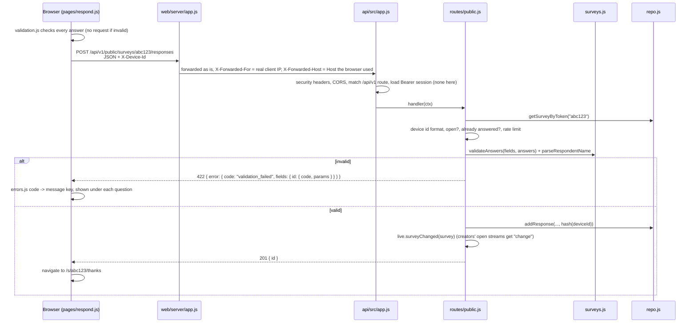
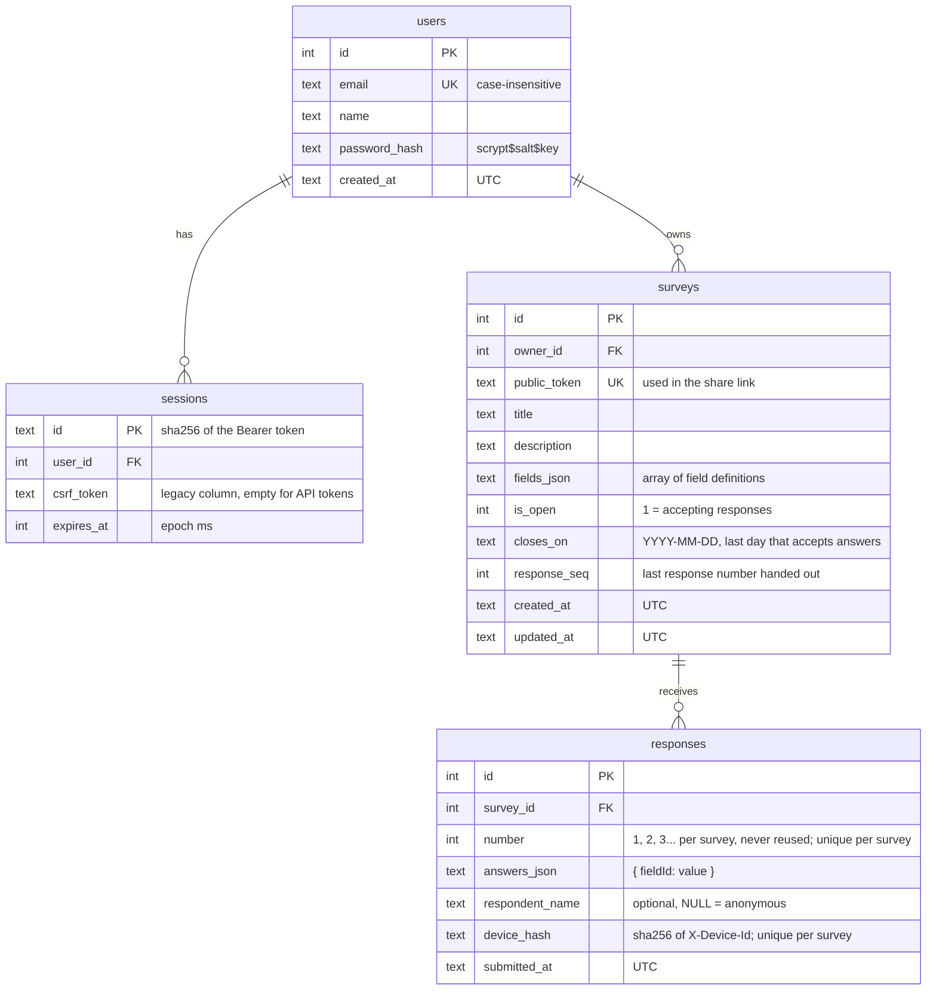

# Sharevy — Code Guide (`api/` and `web/`)

A file-by-file tour of the code: what each module does, what it exports, and why it is built that way.

> **TL;DR** — Sharevy is two packages that only talk HTTP + JSON.
> **`api/`** is the REST API: `app.js` turns each request into a `ctx`, checks the Bearer token, and calls a handler in `routes/`; handlers use `surveys.js` for business rules and `repo.js` for SQLite, and answer JSON (errors as stable codes from `errors.js`). Its only npm dependency is `qrcode` (used only by `qr.js`).
> **`web/`** is the browser client: `server/app.js` (no dependencies) sends `index.html`, the static files, and forwards `/api/*` to the API. In the browser, `public/js/app.js` boots the app, `routes.js` picks a **page** (container: fetches JSON, handles actions) and pages draw **components** (pure functions from data to DOM). No framework, no build step, no `innerHTML`.
> The contract between them is [docs/API.md](docs/API.md).

---

## Table of contents

1. [Map of the code](#1-map-of-the-code)
2. [Life of a request](#2-life-of-a-request)
3. [Layers and dependency rules](#3-layers-and-dependency-rules)
4. [Data model](#4-data-model)
5. [API, file by file](#5-api-file-by-file)
   - [Bootstrap](#bootstrap) — `server.js`, `config.js`, `db.js`
   - [HTTP core](#http-core) — `app.js`, `http.js`, `errors.js`
   - [Routes](#routes) — `routes/meta.js`, `routes/auth.js`, `routes/surveys.js`, `routes/public.js`
   - [Domain](#domain) — `surveys.js`
   - [Infrastructure](#infrastructure) — `repo.js`, `auth.js`, `rate-limit.js`, `live.js`, `qr.js`, `i18n.js`
6. [Web client, file by file](#6-web-client-file-by-file)
   - [Web server](#web-server) — `server.js`, `server/app.js`
   - [App shell](#app-shell) — `index.html`, `main.js`, `app.js`, `routes.js`
   - [Talking to the API](#talking-to-the-api) — `api.js`, `errors.js`, `sse.js`, `storage.js`
   - [Pages (containers)](#pages-containers) — `pages/*.js`
   - [Components (presentational)](#components-presentational) — `components/*.js`, `dom.js`
   - [Pure logic](#pure-logic) — `i18n.js`, `validation.js`, `number-input.js`, `charts.js`, `format.js`
   - [Look and feel](#look-and-feel) — `style.css`, `theme.js`, design tokens, branding
7. [Common changes: where to touch](#7-common-changes-where-to-touch)

---

## 1. Map of the code

```
api/                         REST API, JSON only (port 3001)
├── src/
│   ├── server.js            Entry point: loads config, opens the DB, starts listening
│   ├── config.js            Environment variables -> one config object
│   ├── db.js                Opens SQLite, creates the schema, runs additive migrations
│   ├── app.js               HTTP server: /api/v1 router, Bearer sessions, CORS, JSON errors
│   ├── http.js              JSON body reader, JSON/204 senders, Bearer header, forwarded origin, ISO dates
│   ├── errors.js            Message key -> stable error code; ApiError and the error JSON shape
│   ├── auth.js              Password hashing, random tokens, token hashing
│   ├── rate-limit.js        In-memory rate limiter + client IP detection
│   ├── live.js              Live updates: in-process events streamed as Server-Sent Events
│   ├── qr.js                QR code of the share link (SVG and PNG)
│   ├── i18n.js              The few texts the API writes for people (CSV headers, yes/no), English messages
│   ├── repo.js              All SQL queries (the only file that talks to the DB)
│   ├── surveys.js           Business rules: survey definitions, answers, summary, CSV
│   └── routes/
│       ├── meta.js          /health and /meta (the rules clients must not hard-code)
│       ├── auth.js          Register, login, logout, /me
│       ├── surveys.js       Creator endpoints: CRUD, results, summary, CSV, QR, event streams
│       └── public.js        Respondents: read a survey by token, submit a response
├── locales/                 en.json, es.json (API-side texts only)
├── scripts/create-user.js   Create a creator account from the command line
└── test/                    node:test suites (in-memory database)

web/                         Browser client (port 3000), no dependencies, no build
├── server.js                Entry point: PORT, HOST, API_URL
├── server/app.js            Static files, single-page fallback, /api proxy, CSP, ETags
├── index.html               The one HTML page (top bar + <main>)
├── locales/                 en.json, es.json: every interface text
├── public/
│   ├── js/
│   │   ├── main.js          Module entry point: startApp()
│   │   ├── app.js           App shell: language, theme, session, router, live regions
│   │   ├── routes.js        Path -> page
│   │   ├── api.js           The only door to the API (fetch + Bearer + X-Device-Id)
│   │   ├── errors.js        API error code -> message key
│   │   ├── sse.js           Event streams read with fetch (parser + reconnection)
│   │   ├── storage.js       localStorage keys, device id
│   │   ├── dom.js           h()/s() DOM builders, withParts(), setErrorBox()
│   │   ├── i18n.js          Language choice, t/tn, dates
│   │   ├── validation.js    Respondent answer checks (mirror of the API rules)
│   │   ├── number-input.js  Number question typing filter
│   │   ├── charts.js        Donut and bar math
│   │   ├── format.js        Timestamps, addDays, safeNext
│   │   ├── pages/           Containers: home, auth, surveys, editor, detail, respond
│   │   └── components/      Presentational: layout, icons, builder, answer-field, results
│   ├── style.css, theme.js, logo.png, favicon.svg
│   └── fonts/               IBM Plex Sans woff2 + license
└── test/                    server.test.js (stub API), modules.test.js (pure modules)
```

| File | Lines (approx.) | Layer | One-line purpose |
|------|----:|-------|------------------|
| `api/src/server.js` | 20 | Bootstrap | Start the process |
| `api/src/config.js` | 30 | Bootstrap | Environment → config |
| `api/src/db.js` | 110 | Bootstrap | Schema, migrations, connection |
| `api/src/app.js` | 130 | HTTP core | Request pipeline |
| `api/src/http.js` | 50 | HTTP core | JSON in/out helpers |
| `api/src/errors.js` | 100 | HTTP core | Error codes and shape |
| `api/src/routes/*.js` | 20–190 | Routes | Endpoints |
| `api/src/surveys.js` | 290 | Domain | Validation, summary, CSV |
| `api/src/repo.js` | 125 | Infrastructure | SQL access |
| `api/src/auth.js`, `rate-limit.js`, `live.js`, `qr.js`, `i18n.js` | 20–60 each | Infrastructure | Crypto, abuse protection, SSE, QR, texts |
| `web/server/app.js` | 170 | Web server | Static + proxy |
| `web/public/js/app.js` | 300 | App shell | Boot, router, theme, language, live regions |
| `web/public/js/pages/*.js` | 20–215 | Pages | Fetch, act, compose |
| `web/public/js/components/*.js` | 30–230 | Components | Data → DOM |
| `web/public/js/*.js` (others) | 5–85 each | Pure logic / API client | Tested in `web/test/modules.test.js` |

---

## 2. Life of a request

### Data path: browser → web server → API → domain → database

Example: a respondent submits a survey.



Every API request goes through the same pipeline:

| Step | Where | What happens |
|------|-------|--------------|
| 1 | `web/server/app.js` | `/api/*` is piped to `API_URL` unchanged (method, headers, body, status, streamed answer). `X-Forwarded-For` is overwritten with the real client address, `X-Forwarded-Host`/`-Proto` with the address the browser used |
| 2 | `api/src/app.js` | Security headers and `Cache-Control: no-store` on every response; CORS headers for allowed origins; `OPTIONS` answers 204 |
| 3 | `app.js` | Paths outside `/api/v1` answer 404 |
| 4 | `app.js` → `matchRoute` | First route whose method + path match wins (404 / 405 with `Allow`; 400 for a malformed `%` encoding) |
| 5 | `app.js` → `loadSession` | `Authorization: Bearer <token>` → SHA-256 → unexpired session row → `ctx.user`. Routes registered with `{ auth: true }` answer 401 without it |
| 6 | `routes/*.js` | Handler reads JSON (`readJson`), validates (`surveys.js`), persists (`repo.js`), answers `sendJson` |
| 7 | `app.js` `catch` | `ApiError` → `{ "error": { code, message, params?, fields?, errors? } }` with its status; anything else is logged and becomes `500 internal_error` (no stack traces to clients) |

### Rendering path: URL → page → DOM

```mermaid
sequenceDiagram
    participant U as Browser
    participant W as web/server/app.js
    participant S as public/js/app.js
    participant Rt as routes.js
    participant Pg as pages/detail.js
    participant C as components/results.js

    U->>W: GET /surveys/7
    W-->>U: index.html (status 200; 404 for unknown paths)
    U->>W: GET /public/js/main.js, style.css, /locales/en.json ...
    S->>S: boot: language, GET /api/v1/meta, GET /api/v1/me (if a token is saved)
    S->>Rt: matchRoute("/surveys/7")
    Rt-->>S: { page: detailPage, auth: true }
    S->>Pg: detailPage(app, { params, query, signal })
    Pg->>Pg: GET survey, /summary, /responses (via api.js)
    Pg->>C: kpiTiles(), summaryCharts(), responsesTable()
    C-->>Pg: DOM nodes
    Pg-->>S: { title, body, mounted }
    S->>U: swap <main> (view transition), set title, mounted() opens the live stream
```

In-app links are intercepted and use `history.pushState`, so later navigations skip the HTML and only fetch JSON.

---

## 3. Layers and dependency rules

### API

```
   routes/*  ──►  surveys.js (domain)      pure functions, no I/O
      │      ──►  repo.js    (database)    only place with SQL
      │      ──►  errors.js / http.js / auth.js / rate-limit.js / live.js / qr.js / i18n.js
      ▲
   app.js (wires everything, owns the request lifecycle, /api/v1 prefix)
      ▲
   server.js (process entry point)
```

| Rule | Why it matters |
|------|----------------|
| `surveys.js` has **no I/O** (no DB, no HTTP) | Business rules are unit-tested without a server (`api/test/surveys.test.js`) |
| SQL lives **only** in `repo.js` | Changing the storage engine touches one file |
| The API answers **JSON only**, never HTML | Any client can use it; presentation belongs to clients |
| Errors are **codes**, not sentences | Clients translate them; `message` is English for logs and simple clients |
| Routes receive dependencies (`{ route, repo, config, today, live }`) | Tests build the app with an in-memory DB, custom config and a fake clock |
| `createApp()` does not call `listen()` | Tests start it on a random port; `server.js` decides the real port |

### Web client

```
   pages/*  ──►  components/*   presentational: data -> DOM, no fetch, no navigation
      │     ──►  api.js          the only module that calls the API
      │     ──►  validation.js / number-input.js / charts.js / format.js / i18n.js   pure logic
      ▲
   routes.js ◄── app.js (shell: boot, router, theme, language, live regions)
      ▲
   main.js (module entry point)          server/app.js serves all of it and proxies /api
```

| Rule | Why it matters |
|------|----------------|
| Pages are **containers**: they fetch, handle actions and return `{ title, body, mounted?, redirect? }` | Data flow is in one place per screen |
| Components are **pure functions** from data (and callbacks) to DOM | Easy to reuse and reason about; they keep the same classes as before, so `style.css` applies |
| Only `api.js` calls `fetch` for the API (plus `sse.js` for streams) | Token, device id and error handling are in one place |
| DOM is built with `h()` / `s()` from `dom.js`, **never** `innerHTML` | User text cannot become markup; the token in `localStorage` stays hard to steal |
| Pure modules have no DOM or network access | Tested with `node --test`, no browser needed |
| No inline scripts or styles | The CSP forbids them |

---

## 4. Data model



**Why JSON columns for fields and answers?** Every survey has a different shape. Storing the definition (`fields_json`) and the answers keyed by field id (`answers_json`) avoids a dynamic schema, and keeps old answers readable after the survey is edited, because field ids are stable.

All foreign keys use `ON DELETE CASCADE`: deleting a survey deletes its responses; deleting a user deletes their sessions and surveys.

The database file (`data/surveys.db`) is the same one the single-server version used: migrations are additive, so existing data keeps working. Dates are stored as SQLite UTC text and leave the API as ISO 8601 (`isoUtc`).

---

## 5. API, file by file

### Bootstrap

#### `server.js` — process entry point

**Purpose:** the only file with side effects at import time. Run with `npm start` in `api/` (or `npm run start:api` at the root).

| Does | Detail |
|------|--------|
| Loads config | `loadConfig()` from environment variables |
| Opens the database | `openDatabase(config.dbPath)` |
| Starts the HTTP server | `createApp({ db, config }).listen(port, host)` |
| Graceful shutdown | On `SIGINT` / `SIGTERM`: closes open connections (including event streams), the server and the DB |

> Keep this file thin. Anything worth testing belongs in `app.js` or below.

---

#### `config.js` — configuration

**Exports:** `loadConfig(env = process.env)` → plain object; `REPO_ROOT`; `isLoopback(host)` (also used by the start-up warning in `server.js`).

| Key | Env var | Default | Used by |
|-----|---------|---------|---------|
| `port` | `PORT` | `3001` | `server.js` |
| `host` | `HOST` | `127.0.0.1` (only the web proxy reaches the API; `0.0.0.0` exposes it) | `server.js` |
| `dbPath` | `DB_PATH` | `data/surveys.db`, relative to the repository root | `server.js`, `scripts/create-user.js` |
| `webBaseUrl` | `WEB_BASE_URL` (fallback `BASE_URL`) | `null`: the forwarded address, else `DEFAULT_WEB_BASE_URL` (`http://localhost:3000`) | `routes/surveys.js` share link and QR |
| `corsOrigins` | `CORS_ORIGINS` (comma-separated, `*` = any) | `['http://localhost:3000']` | `app.js` → `applyCors` |
| `allowRegistration` | `ALLOW_REGISTRATION` | `true` | `routes/auth.js`, `/meta` |
| `sessionTtlMs` | — | 7 days | `routes/auth.js` |
| `trustProxy` | `TRUST_PROXY` | `true` on a loopback host (`isLoopback`), else `false`; an explicit value wins | `rate-limit.js` → `clientIp` |
| `loginMaxFailures` | `LOGIN_MAX_FAILURES` | `10` | `routes/auth.js` |
| `loginWindowMs` | — | 15 min | `routes/auth.js` |
| `submissionLimit` | `SUBMISSION_LIMIT` | `60` (`0` = off) | `routes/public.js` |
| `submissionWindowMs` | — | 10 min | `routes/public.js` |
| `now` | — (tests only) | `() => new Date()` | `app.js` → `today()`, the clock used for closing dates |

**Design note:** it takes `env` as a parameter instead of reading `process.env` directly, so tests can call `loadConfig({})` and override single keys. Relative `DB_PATH` values are resolved from `REPO_ROOT`, so the API finds the same database whatever folder it starts from.

---

#### `db.js` — database connection and schema

**Exports:** `openDatabase(path)` → `DatabaseSync` instance.

| Step | Why |
|------|-----|
| Creates the parent folder | First run works without manual setup |
| `PRAGMA foreign_keys = ON` | SQLite disables FK enforcement by default; cascades need it |
| `PRAGMA journal_mode = WAL` | Readers do not block the writer |
| `PRAGMA busy_timeout = 5000` | Waits instead of failing if the DB is briefly locked |
| `CREATE TABLE IF NOT EXISTS …` | Idempotent schema: safe to run on every boot |

Pass `':memory:'` for a throwaway database (the tests do this).

**Migrations:** after the base schema, `migrate()` runs the `MIGRATIONS` list inside one transaction: `respondent_name`, `closes_on` (existing surveys get creation date + 10 days, once), `device_hash` with the unique index `(survey_id, device_hash)`, and per-survey response numbers: `surveys.response_seq` plus `responses.number` with the unique index `(survey_id, number)` (existing responses are numbered 1..n per survey by `id`, once, and each counter set to its survey's highest number). Each step checks the current shape first (`hasColumn`), so steps are idempotent and run on every boot. Add new steps at the end of the list; never edit a released step.

---

### HTTP core

#### `app.js` — the request pipeline

**Exports:** `API_PREFIX` (`/api/v1`), `createApp({ db, config })` → a `node:http` `Server` (not listening yet).

**What it builds once, at startup:** `repo`, the `live` updates hub, the `today()` clock, and the routes table. Each `route(method, '/path/:param', handler, { auth })` compiles to a regex (relative to `/api/v1`); `:param` matches one path segment.

**Per request:**

| Function | Responsibility |
|----------|----------------|
| Security headers | `Content-Security-Policy: default-src 'none'; frame-ancestors 'none'; base-uri 'none'`, `X-Frame-Options: DENY`, `nosniff`, `no-referrer`, `Cache-Control: no-store` |
| `applyCors(req, res)` | Only for an `Origin` in `corsOrigins` (or `*`): echoes the origin, exposes `Retry-After` and `Content-Disposition`; preflight allows `Authorization`, `Content-Type`, `X-Device-Id`. Requests without `Origin` (curl, mobile apps, the web proxy's same-origin calls) need none |
| `matchRoute(method, path)` | Handler + decoded params. 405 with `Allow` if the path exists with another method, 404 if not, 400 for malformed `%` encoding |
| `loadSession(ctx)` | Bearer token → `hashToken` → `repo.getSession` (ignores expired) → `ctx.session`, `ctx.user` |
| Error boundary | `ApiError` → its JSON and status (and extra `headers`, e.g. `Retry-After`). Unknown error → logged + `500 internal_error` |

**The `ctx` object** passed to every handler:

```js
{ req, res, url, params, user, session }
// user    → { id, name, email } | null
// session → the sessions row | null
```

> **Order matters:** routes are matched in registration order. `/surveys/events` is registered before `/surveys/:id`, otherwise `events` would be captured as an id.

---

#### `http.js` — JSON helpers

| Export | What it does |
|--------|--------------|
| `readJson(req, limit = 1 MB)` | Reads an `application/json` body and returns a plain object. Empty body → `{}`. 413 over the limit, 415 for another content type with a body, 400 `invalid_json` / `invalid_body` (not an object) |
| `sendJson(res, status, data, headers)` | JSON response |
| `sendNoContent(res)` | `204` |
| `bearerToken(req)` | The token of `Authorization: Bearer <token>`, or `undefined` |
| `forwardedOrigin(req)` | `"proto://host[:port]"` from `X-Forwarded-Proto` (`http`/`https`) and `X-Forwarded-Host` (`hostname[:port]` characters only), or `undefined` |
| `isoUtc(sqliteDate)` | `"2026-11-17 10:00:00"` → `"2026-11-17T10:00:00Z"` |

---

#### `errors.js` — error codes

| Export | What it does |
|--------|--------------|
| `ERROR_CODES` | Message key (`api/locales/en.json`) → stable snake_case code sent to clients (`validation.titleRequired` → `title_required`). Codes never change once published: add new ones instead |
| `ApiError(status, key, params, details)` | Throwable error; `toJSON()` gives `{ error: { code, message, params?, fields?, errors? } }`. `message` is English |
| `coded(key, params)` | A translator for the domain functions that returns `{ code, params, message }` instead of a sentence, so each problem reaches the client as a code |
| `validationFailed({ fields?, errors? })` | `422 validation_failed`. `fields` = per-field problems (answers, registration); `errors` = an ordered list (survey definition) |

The full list with statuses and English messages is in [docs/API.md, section 10](docs/API.md#10-error-code-reference). `api/test/i18n.test.js` checks that every message maps to a code and back.

---

### Routes

Every route file exports `register*Routes(deps)` and only registers handlers. Nothing runs at import time. The full contract (bodies, examples, statuses) is in [docs/API.md](docs/API.md); this section explains the internals.

#### `routes/meta.js` — server description

| Method | Path | Result |
|--------|------|--------|
| GET | `/health` | `{ status: 'ok' }` |
| GET | `/meta` | Field types, choice types, yes/no values, `LIMITS`, `defaultOpenDays`, the server's `today`, CSV options, `allowRegistration`, `deviceIdPattern` |

`/meta` exists so clients **never hard-code** rules: the editor and the respondent form read their limits and types from it. `today` is the server's date because closing dates are compared with it, not with the client's clock.

---

#### `routes/auth.js` — creator accounts

| Method | Path | Auth | Result |
|--------|------|------|--------|
| POST | `/auth/register` | — | `201 { token, user }` · 422 with `fields` · 404 `registration_disabled` |
| POST | `/auth/login` | — | `200 { token, user }` · 401 `invalid_credentials` · 429 `too_many_login_attempts` |
| POST | `/auth/logout` | — | Ends the session of the token sent, if any. Always 204 |
| GET | `/me` | Bearer | `{ user }` |

**Key internals:**

- **`startSession`** — purges expired sessions, creates a random 32-byte token, stores **its SHA-256 hash**, and returns the raw token once.
- **Login timing** — when the email does not exist, the password is still checked against `DUMMY_HASH`, so response time does not reveal which emails are registered.
- **Brute-force limiter** — keyed by `email|ip`. After `loginMaxFailures` failures in 15 minutes it answers 429 with `Retry-After`. A successful login resets the counter. Keying by email **and** IP means an attacker on another machine cannot lock a colleague out.
- **Registration rules** — name 1–100 characters, valid email up to 254, password 8–200 characters, `confirm` must match when sent, email unique (case-insensitive).

---

#### `routes/surveys.js` — creator endpoints

All routes need a Bearer token (`authed(...)` registers them with `{ auth: true }`).

| Method | Path | Result |
|--------|------|--------|
| GET | `/surveys` | The creator's surveys (without fields) with response counts and status |
| GET | `/surveys/events` | Live stream (SSE) for the creator's list; registered before `/surveys/:id` |
| POST | `/surveys` | Create → `201 { survey }` · 422 with ordered `errors` |
| GET | `/surveys/:id` | `{ survey }` with fields, status, `shareUrl` |
| PUT | `/surveys/:id` | Replace the definition (field ids are preserved) |
| PATCH | `/surveys/:id` | `{ isOpen }`: open ↔ closed |
| DELETE | `/surveys/:id` | Delete the survey and its responses → 204 |
| GET | `/surveys/:id/events` | Live stream (SSE) for one survey |
| GET | `/surveys/:id/responses` | Responses, newest first |
| DELETE | `/surveys/:id/responses/:responseId` | Delete one response (idempotent 204) |
| GET | `/surveys/:id/summary` | Key figures (`kpis`) and per-question counts with percentages: the server counts, clients only draw |
| GET | `/surveys/:id/export.csv?delimiter=comma\|semicolon&lang=en\|es` | CSV download (UTF-8 with BOM); `lang` defaults to `Accept-Language`, then English |
| GET | `/surveys/:id/qr.svg`, `/surveys/:id/qr.png` | QR code of `shareUrl` (PNG as an attachment) |

**Key internals:**

- **`ownedSurvey(ctx)`** — the single ownership gate. It loads the survey by id **and** `owner_id = ctx.user.id`; otherwise 404. Returning 404 instead of 403 means another creator cannot even tell that the survey exists.
- **`shareUrl(ctx, survey)`** — base + `/s/<publicToken>`: respondents open surveys in the **web client**, not the API. Base: `WEB_BASE_URL`; else, with `trustProxy`, `forwardedOrigin(req)` (`http.js`: `X-Forwarded-Proto` + a `hostname[:port]` `X-Forwarded-Host`); else `DEFAULT_WEB_BASE_URL`.
- **`readDefinition`** — turns the JSON body into the shape `parseSurveyInput` expects and throws `validationFailed({ errors })` with coded problems.
- **Public token** — `newToken(18)` gives 144 random bits, so links cannot be guessed or enumerated.
- **CSV BOM** — the `` prefix makes Excel read accented characters correctly. The `;` variant exists for Excel with Spanish/European regional settings.
- Every write calls `live.surveyChanged(survey)`.

---

#### `routes/public.js` — respondents (no account)

| Method | Path | Result |
|--------|------|--------|
| GET | `/public/surveys/:token` | Title, description, closing date, `status`, fields, `alreadyAnswered` for this `X-Device-Id` |
| POST | `/public/surveys/:token/responses` | `201 { id, number }` (plus `deviceId` when none was sent) · 400 · 403 · 409 · 422 · 429 |

**Order of checks on submit** (cheapest and most decisive first):

1. Survey exists? Otherwise 404 `not_found`.
2. `X-Device-Id` well formed (`DEVICE_ID`, 20–100 base64url characters)? Otherwise 400 `invalid_device_id`.
3. Survey open? Otherwise 403 `survey_closed` / `survey_expired`.
4. Device already answered? Otherwise 409 `already_answered`.
5. Under the rate limit for `surveyId|ip`? Otherwise 429 with `Retry-After`.
6. Answers valid (`validateAnswers`, `parseRespondentName`)? Otherwise 422 with `fields`.
7. Store (the unique index settles races with another 409), count against the limit, notify live streams.

`answersForm()` turns the JSON answers into the name/value pairs `validateAnswers` reads (`f_<fieldId>`, repeated for checkbox lists), so the domain function is the same one the single-server version used.

**One response per device:** the client generates a random id once and sends it as `X-Device-Id`. Its hash goes to `responses.device_hash`, and a unique index on `(survey_id, device_hash)` makes the database reject a second response, even when two submissions race. A new id (cleared site data, another browser) counts as a new device: this stops accidental and casual duplicates, not determined abuse. Invalid submissions do not count toward the rate limit.

---

### Domain

#### `surveys.js` — business rules (pure functions)

The heart of the API. It has no database, no HTTP and no JSON output, which is why it can be unit-tested in isolation.

**Constants**

| Export | Content |
|--------|---------|
| `FIELD_TYPE_IDS` | `text`, `textarea`, `number`, `email`, `date`, `select`, `radio`, `yesno`, `checkbox`, in menu order. Clients name them (`fieldType.<id>` in `web/locales`) |
| `CHOICE_TYPES` | `select`, `radio`, `checkbox` (the types whose options the creator writes) |
| `YES_NO` | `['yes', 'no']`: the fixed, language-independent values stored for a `yesno` question |
| `LIMITS` | title 200, description 2 000, label 300, fields 100, options 100, option 200, text 1 000, textarea 10 000, respondentName 100 |
| `DEFAULT_OPEN_DAYS` | 10 |

**Field definition** (one item of `fields_json`):

```js
{ id: 'a1b2c3d4e5f6', label: 'Department', type: 'select', required: true, options: ['IT', 'HR'] }
```

**Messages:** functions take a translator `t` in their options. The routes pass `coded` (from `errors.js`), so each problem becomes `{ code, params, message }`; CSV uses the real translator of the requested language; unit tests can omit it (English).

**Functions**

| Function | Input → Output | Notes |
|----------|----------------|-------|
| `parseSurveyInput({ title, description, fieldsJson, closesOn }, { today, currentClosesOn, t })` | → `{ value, errors[] }` | Empty `closesOn` defaults to `today` + `DEFAULT_OPEN_DAYS`. A past date is rejected unless it is the survey's current date (editing an expired survey). Trims, enforces limits, ignores blank options. **Rejects repeated options in one question and two questions with the same text** (equal after trimming, ignoring case): multiple-choice answers are stored by option text, so repeats could not be told apart. **Keeps a valid existing `id`** so edits do not orphan answers; generates a new one when it is missing, invalid or duplicated |
| `validateAnswers(fields, form, { t })` | → `{ answers, errors{fieldId: problem} }` | Reads only defined fields (`f_<id>`), so extra keys are ignored. Checks type, required, and that choices are among the options. Checkbox values are returned in option order |
| `surveyStatus(survey, today)` | → `'open' \| 'closed' \| 'expired'` | `closed` = switched off by the creator; `expired` = `today` is after `closesOn`. Only `open` accepts answers |
| `localDateString(date)`, `addDays(date, n)`, `daysBetween(from, to)` | → `YYYY-MM-DD` / whole days | Server-local calendar date; calendar math without time zones; "days left" |
| `parseRespondentName(value, { t })` | → `{ name, error }` | Optional, trimmed, max 100 characters, empty means anonymous |
| `formatAnswer(value)`, `answerText(field, value, t)` | → `string` | Arrays become `"a, b"`; `yes`/`no` translated (CSV) |
| `fieldOptions(field)` | → `string[]` | `YES_NO` for `yesno`, otherwise the creator's options |
| `summarize(fields, responses, { t })` | → per choice field (yes/no included): `answered`, counts per option | Feeds `/summary`, which adds percentages |
| `csvCell(value, delimiter)` | → escaped cell | Quotes when needed. Prefixes `'` to values starting with `= + - @` (formula injection), except plain numbers like `-5` |
| `toCsv(fields, responses, delimiter, { t })` | → full CSV text | Header (fixed columns in the requested language) + rows in submission order, first column = per-survey `number`, `\r\n` line endings |

**Validation per type** (mirrored in `web/public/js/validation.js`)

| Type | Accepted value | Error code |
|------|----------------|------------|
| `text` | Up to 1 000 characters | `too_long` |
| `textarea` | Up to 10 000 characters | `too_long` |
| `number` | Anything `Number()` parses as finite | `invalid_number` |
| `email` | `x@y.z` shape, up to 254 characters | `invalid_email` |
| `date` | `YYYY-MM-DD` that is a real calendar date (`2026-02-30` is rejected) | `invalid_date` |
| `select`, `radio` | Exactly one of the options | `invalid_option` |
| `yesno` | `yes` or `no` | `invalid_option` |
| `checkbox` | Any subset of the options; `required` means at least one | `invalid_option` / `required` |

---

### Infrastructure

#### `repo.js` — data access

**Exports:** `createRepo(db)` → object with one method per query. It is the **only** file that contains SQL.

| Group | Methods |
|-------|---------|
| Users | `createUser`, `findUserByEmail`, `findUserById` |
| Sessions | `createSession`, `getSession` (ignores expired ones), `deleteSession`, `deleteExpiredSessions` |
| Surveys | `listSurveys(ownerId)`, `createSurvey`, `getOwnedSurvey(id, ownerId)`, `getSurveyByToken`, `updateSurvey`, `setSurveyOpen`, `deleteSurvey` |
| Responses | `addResponse` (returns `{ id, number }`, or `{ error: 'alreadyAnswered' }` when the device already answered and `{ error: 'surveyMissing' }` when the survey was deleted meanwhile, both rolled back), `hasDeviceResponse`, `listResponses` (newest first), `deleteResponse(surveyId, responseId)` |

**Design notes:**

- Every write on a survey filters by `owner_id`, and `deleteResponse` filters by `survey_id`. Ownership is enforced **in SQL too**, not only in the route.
- Only positional `?` parameters are used, never string interpolation, so SQL injection is not possible.
- `hydrateSurvey` / `hydrateResponse` convert rows (snake_case, JSON strings, `0/1`) into app objects (camelCase, parsed JSON, booleans). Routes then shape them into the API's JSON.

---

#### `auth.js` — crypto helpers

| Export | What it does |
|--------|--------------|
| `newToken(bytes = 32)` | Random URL-safe token (Bearer tokens, survey links, server-picked device ids) |
| `hashPassword(pw)` | scrypt with a random 16-byte salt → `"scrypt$<salt>$<key>"` |
| `verifyPassword(pw, stored)` | Recomputes and compares in constant time; `false` for malformed hashes |
| `hashToken(token)` | SHA-256 of a secret (Bearer tokens, device ids). A leaked DB does not give usable tokens |
| `safeEqual(a, b)` | Constant-time string comparison |
| `DUMMY_HASH` | Precomputed hash for the "unknown email" login path |

**Why scrypt?** It is built into Node (no native dependency to compile on Windows) and is memory-hard, which makes GPU brute force expensive. The `scrypt$` prefix leaves room to switch algorithms later.

---

#### `rate-limit.js` — abuse protection

| Export | What it does |
|--------|--------------|
| `createRateLimiter({ limit, windowMs, now?, maxKeys? })` | Fixed-window counter per key: `isLimited`, `hit`, `reset`, `retryAfterSeconds`. `limit: 0` disables it |
| `clientIp(req, trustProxy)` | Socket address, or the first `X-Forwarded-For` entry **only** when `trustProxy` is on |

| Choice | Consequence |
|--------|-------------|
| In memory | Zero setup; counters reset when the process restarts and are not shared between processes |
| Fixed window | Simple and predictable; allows a short burst at window edges |
| `maxKeys` cap (10 000) | Memory stays bounded: expired keys are pruned first, then the oldest |
| `X-Forwarded-For` opt-in | Otherwise any client could fake its IP. Behind the web proxy every request comes from `127.0.0.1`, so on a loopback host `trustProxy` is on by default to count people; the proxy always overwrites the header, so it cannot be faked through it |

---

#### `live.js` — live updates

**Exports:** `createLiveUpdates()` → `{ surveyChanged(survey), stream(req, res, channel) }`. `app.js` creates one instance and passes it to the routes as `live`.

| Piece | Detail |
|-------|--------|
| Channels | `survey:<id>` (results page) and `owner:<userId>` (survey list) |
| Publishers | A new response (`routes/public.js`); creating, editing, opening/closing, deleting a survey or a response (`routes/surveys.js`) |
| `stream()` | `text/event-stream`: `retry: 3000` and `: connected` on open, `event: change` per change, `: ping` every 25 s, cleanup on disconnect. `X-Accel-Buffering: no` for buffering proxies |

**Why events carry no data:** clients re-fetch the same JSON as a manual refresh, so a live update can never show something different from a reload. **Limits:** events live in memory in one process; several API processes would need a shared bus (for example Redis pub/sub).

---

#### `qr.js` — QR codes

| Export | What it does |
|--------|--------------|
| `qrSvg(text, label)` | SVG with `role="img"` and an accessible name |
| `qrPng(text)` | 600px PNG, large enough to print |

Medium error correction and a 2-module margin. The QR always encodes `shareUrl`: the address the creator's browser used, or `WEB_BASE_URL` when set. Only `qr.js` imports `qrcode`, so replacing the library touches one file.

---

#### `i18n.js` — API-side texts

The API speaks English in error messages; clients translate the codes. Other languages only cover what the API itself writes for people: CSV headers and yes/no labels in CSV.

| Export | What it does |
|--------|--------------|
| `SUPPORTED_LANGUAGES`, `DEFAULT_LANGUAGE` | `['en', 'es']`, `'en'` |
| `isSupportedLanguage(code)` | Validates `?lang=` |
| `negotiateLanguage(acceptLanguage)` | First supported language by q-value (`es-MX` → `es`); otherwise English |
| `createI18n(lang)` | `{ lang, t(key, params) }`; missing keys fall back to English, then the key |
| `defaultI18n` | English translator (used for `message` in errors) |

`api/locales/<code>.json` holds `answer.*`, `csv.*`, and the English messages of every error key. `api/test/i18n.test.js` checks that every language has the CSV and yes/no keys and keeps every `{placeholder}`.

---

## 6. Web client, file by file

### Web server

#### `server.js` — entry point

Reads `PORT` (3000), `HOST` (`0.0.0.0`) and `API_URL` (`http://127.0.0.1:3001`), starts `createWebServer({ apiUrl })`, and on `SIGINT` / `SIGTERM` stops with `closeServer`, which also ends open proxied event streams (otherwise they would keep the process alive).

#### `server/app.js` — static files and API proxy

**Exports:** `createWebServer({ apiUrl, root })`, `closeServer(server)` (close + `closeAllConnections`, resolves when closed), `APP_ROUTES`, `WEB_ROOT`.

| Path | Answer |
|------|--------|
| `/api`, `/api/*` | **Proxied** to `apiUrl`: method, headers (minus hop-by-hop), body, status and streamed answer, so event streams flow through. `X-Forwarded-For` is set to the real client address and `X-Forwarded-Host` to the `Host` the browser sent (client-sent values are never kept). API down → `502 { error: { code: 'api_unavailable' } }`. A closed tab ends the upstream request too |
| `/public/*`, `/locales/*` | Files from those folders only. Decoded `..`, `.`, backslashes and NUL are refused before touching the disk |
| `APP_ROUTES` (`/`, `/login`, `/register`, `/surveys`, `/surveys/new`, `/surveys/<n>`, `/surveys/<n>/edit`, `/s/<token>`, `/s/<token>/thanks`) | `index.html`, status 200 |
| Anything else | `index.html` with status 404 (the router shows "page not found") |
| Non-GET/HEAD outside `/api` | 405 |

| Header | Why |
|--------|-----|
| `Content-Security-Policy` | `default-src 'self'; script-src 'self'; style-src 'self'; img-src 'self' data: blob:; connect-src 'self'; ...`: only this origin's code, nothing inline. `blob:` is the QR image, fetched with the token |
| `Cache-Control: no-cache` + `ETag` | Without a build step, module URLs never change, so the browser revalidates every file (a cheap 304) and never runs a stale module |
| Fonts: `immutable`, 1 year | A new font version gets a new file name |

**Why a proxy instead of CORS?** The browser sees one origin, so no CORS preflights, the API can stay on localhost, and share links on the LAN keep the old address. See [web/README.md](web/README.md).

---

### App shell

#### `index.html`, `main.js`

`index.html` is the only page: the top bar with the logo, an empty `<main>`, `theme.js` (applies the saved theme before paint), the stylesheet and `main.js` as a module. A `<noscript>` message explains that JavaScript is needed. `main.js` just calls `startApp()`.

#### `app.js` — the application shell

**Exports:** `startApp()`. Builds the `app` object every page receives:

| Member | What it is |
|--------|------------|
| `app.user`, `app.token`, `app.meta` | Current creator (or `null`), Bearer token, the API's `/meta` |
| `app.i18n`, `app.t`, `app.tn`, `app.languages` | Translator of the current language; language names for the menu |
| `app.api` | The API client (`createApi`) |
| `app.navigate(to, { replace })`, `app.render()` | Router |
| `app.setSession(session)` | Saves or forgets `{ token, user }` |
| `app.deviceId()`, `app.rememberDevice(id)` | Respondent device id (`storage.js`) |
| `app.error(err, keys)` | Message for an error (`errors.js`) |
| `app.showError(err, respondent)` | Error panel for a failed action |
| `app.liveRegion(region, url, build, signal)` | Live updates for one region (below) |
| `app.announce(text)` | Polite screen-reader announcement |

**Boot:** pick the language (`pickLanguage`), load its locale, then in parallel `GET /meta`, `GET /me` (if a token is saved; a 401 forgets it) and every locale file (for the language menu names). Then the first render.

**Router (`render`)**: aborts the previous page's `AbortController` (stops its event streams), matches the path, redirects `auth` pages to `/login?next=...` without a user, calls the page, and swaps `<main>` inside a View Transition (skipped for reduced motion or a hidden tab). It also sets `document.title` (`<page> · Sharevy`), toggles `body.respondent`, redraws the top bar and shows a flash message for known `?msg=` keys (`created`, `saved`, `closed`, `opened`, `deleted`, `response-deleted`; the query value is never reflected). A page error becomes an error panel; a 401 goes to the login page through `onUnauthorized`. Clicks on same-origin links (not `/api/`, `/public/`, downloads or new tabs) are intercepted and use `pushState`.

**Live regions (`liveRegion`)**: `followEvents` keeps a stream open on `/api/v1<url>`; each `change` calls `build()` again, and only when the new DOM differs from the shown one it replaces the region, restarts the `.live-updated` highlight and announces "results updated". Refreshes never overlap (one queued at most).

**Theme and language**: the theme button toggles `data-theme` on `<html>` and saves `sharevy-theme`; without a choice, `prefers-color-scheme` decides and labels follow OS changes. The language menu saves `sharevy-lang`, loads the locale and re-renders the current page without reloading; it closes on an outside click or Escape.

#### `routes.js` — path → page

`ROUTES` lists each path with its page and flags: `auth` (needs a creator), `respondent` (minimal top bar, no account menu), `errorKeys` (clearer messages, e.g. `not_found` on a share link → "this survey does not exist"). `matchRoute(pathname)` returns the route and params (`:id` digits, `:token` base64url). **Keep it in sync with `APP_ROUTES` in `server/app.js`**, or a reload on the new page answers 404.

---

### Talking to the API

#### `api.js` — the only door to the API

| Export | What it does |
|--------|--------------|
| `API_BASE` | `/api/v1` (same origin, through the proxy) |
| `createApi({ getToken, onUnauthorized })` | `get`, `post`, `put`, `patch`, `del` (JSON in and out, `null` for 204), `file(path)` (Blob + suggested name), `authHeaders()` |
| `ApiError` | `status`, `code`, `params`, `fields`, `errors`, `retryAfter`. Network failure → `network_error`; non-JSON 502/503/504 → `api_unavailable` |
| `saveBlob(blob, name)` | Starts a download (CSV, QR PNG): the API needs the Bearer header, so plain links cannot |

Every request sends `Authorization: Bearer <token>` when logged in and `X-Device-Id` when the caller passes `deviceId`. A 401 with a token calls `onUnauthorized` (the shell forgets the session and goes to login).

#### `errors.js` — code → message

`ERROR_KEYS` maps every API error code (plus `api_unavailable` and `network_error`) to a key in `web/locales`. `errorMessage(problem, t, keys)` uses page-specific `keys` first, then `ERROR_KEYS`, then the API's English `message` for codes from a newer API. `web/test/modules.test.js` checks every code has a translation in every language.

#### `sse.js` — live updates over fetch

`EventSource` cannot send headers, and the token must never travel in the URL, so streams are read with `fetch` and a body reader.

| Export | What it does |
|--------|--------------|
| `createSseParser(onMessage)` | Incremental parser: joins chunks, skips comments (`: ping`), reads `event`, `data`, `retry` |
| `backoffDelay(attempt, retryMs)` | Reconnection wait: doubles each attempt, at most 30 s |
| `followEvents({ url, headers, onChange, onUnauthorized, signal })` | Keeps one stream open until `signal` aborts; calls `onChange` per `change` and once after each reconnection (events may have been missed); a 401 stops it |

#### `storage.js` — what the browser remembers

`KEYS`: `sharevy-token`, `sharevy-device`, `sharevy-lang`, `sharevy-theme`. `load` / `save` fall back to memory when storage is blocked (private mode). `deviceId(pattern)` returns the saved device id or makes one (32 random bytes, base64url). The token tradeoff is documented here and in [web/README.md](web/README.md#tradeoffs).

---

### Pages (containers)

A page is `async (app, { params, query, signal }) → { title, body, respondent?, redirect?, status?, mounted? }`. It fetches with `app.api` (passing `signal`, so a newer navigation cancels it), composes components, and attaches action handlers. `mounted()` runs after the DOM is on screen (live streams, QR image).

| File | Pages | What they do |
|------|-------|--------------|
| `home.js` | `homePage` | Landing with steps and login/register buttons (register only when `meta.allowRegistration`); logged-in creators go to `/surveys` |
| `auth.js` | `loginPage`, `registerPage` | Forms; API errors in a box above the form (registration in field order); keep typed values (never the password); after login go to `safeNext(next)`; the submit button is disabled while sending |
| `surveys.js` | `surveyListPage` (+ `surveyCards`) | Cards with status badge, response count and closing text; live via `/surveys/events` |
| `editor.js` | `editorPage` | New / edit. Reads `/meta` for limits, types, `today` and `defaultOpenDays` (default closing date, `min` of the date input). Title and closing date are checked with the questions by the builder; API `errors[]` are shown in order above the form. Warns when editing a survey with responses |
| `detail.js` | `detailPage` | Share link (copy button with a fallback for plain HTTP, native share sheet when supported), QR image (`qr.svg` fetched as a blob), PNG download, CSV downloads (`?lang=` = current interface language), open/close, delete (confirm), key figures, charts, responses table with delete; results live via `/surveys/:id/events` |
| `respond.js` | `respondPage`, `thanksPage` | Respondent form, closed / expired / already-answered panels, thanks page. Sends `X-Device-Id`, keeps a `deviceId` the API returns. Checks every answer in the browser first (`attachValidation`); API `fields` errors use the same markup |

**Respondent form behavior (`respond.js` + `answer-field.js`):**

| Behavior | Detail |
|----------|--------|
| Checks before sending | On submit, every answer is checked with `checkAnswer` / `checkRespondentName` (`validation.js`). Invalid → nothing is sent; errors appear under each question (`.has-error`, `.field-error`, `aria-invalid` / `aria-describedby`), plus the `.errors` summary with a link to each, and the first invalid question gets the focus. A question's error clears as soon as its answer is valid. The form sets `noValidate` so browser bubbles do not compete |
| Server errors | A 422 `fields` map is translated with `errors.js` and shown with the same markup; `already_answered`, `survey_closed`, `survey_expired` switch to their panels. Any other failure (network down, `api_unavailable`, `too_many_responses`...) shows its translated message in the `.errors` box above the form; the form and its answers stay, so the respondent can send again |
| Number questions | A text input with `inputmode="decimal"` (a number input hides the typed text and cursor from scripts). Only digits, one point and a leading `-` can be typed, pasted or dropped (`beforeinput`, with an `input` safety net); a comma becomes a point; Up/Down add or subtract 1 (`number-input.js`) |

---

### Components (presentational)

Pure functions from data (and callbacks) to DOM. They never fetch or navigate on their own, and they keep the classes, ids and roles of the single-server markup, so `style.css` applies unchanged.

| File | Exports | Notes |
|------|---------|-------|
| `layout.js` | `APP_NAME`, `topbar`, `themeToggle`, `languageMenu`, `flash`, `errorList`, `notice`, `backLink`, `emptyState`, `statusBadge`, `statusKey`, `closingText`, `resultPanel`, `errorPanel` | The language menu is a native `<details class="lang-menu">`: a globe and the current code, one link per language named in its own language, `aria-current` on the current one; on phones it opens under the whole top bar |
| `icons.js` | `icon(name, extraClass)` | Stroke icons on a 24×24 grid, built with `s()`. Icon-only buttons always carry an `aria-label` and a `title` |
| `builder.js` | `createBuilder({ fields, types, choiceTypes, limits, t, basics })` → `{ element, validate(), value() }` | Question editor: add, move, duplicate, delete. Warns about repeated questions and options **while typing**; empty question text, missing options, title and closing date (`basics`) **after a submit attempt**. Same rule as the API: equal after trimming, ignoring case. Keeps field ids so edits do not orphan answers |
| `answer-field.js` | `answerField(field, index, i18n, limits)`, `respondentNameField`, `fieldError` | One control per type (`yesno`: two large side-by-side radios, `.choices.yesno`; choices in a `fieldset` + `legend`); control id `fld_<question id>` |
| `results.js` | `kpiTiles`, `summaryCharts`, `responsesTable` | Key figures (`<dl class="kpis">`), charts, and the table (one card per response on phones, via each cell's `data-label`). Yes/no shown translated |

**Charts** (`summaryCharts`, math in `charts.js`):

| Question type | Chart | Why |
|---------------|-------|-----|
| `radio`, `select` (up to 6 options), `yesno` | Donut + legend with count and % | One answer per person: the shares add up to 100% |
| `checkbox` | Horizontal bars + a note | Several answers per person: the % add up to more than 100%, so a pie would mislead |
| `radio`, `select` with more than 6 options | Bars | Categorical colors are never repeated |

The SVG is `aria-hidden`; the legend and bar labels carry every number as text. Colors come from classes (`.slice-1`…`.slice-6` → `--cat-1`…`--cat-6`, `--bar-fill`), defined for light and dark in `style.css` from a muted palette checked with a colorblind validator (lightness band, chroma floor, CVD separation, >= 3:1 against the panel), so no inline `style` is needed.

#### `dom.js` — safe DOM building

| Export | What it does |
|--------|--------------|
| `h(tag, attrs, ...children)` | Element; strings become **text nodes**; `on*` functions become listeners; `value`, `checked`, `disabled`... are set as properties |
| `s(tag, attrs, ...children)` | Same for SVG |
| `withParts(text, parts)` | A translated sentence with nodes in its `{placeholders}` ("No account yet? {link}.") |
| `setErrorBox(form, box)` | Puts an `.errors` box (or nothing, with `null`) right above a form, replacing the previous one; used by the editor and the respondent form |

There is no `innerHTML` anywhere in the client: user text can never become markup.

---

### Pure logic

All tested in `web/test/modules.test.js` with `node --test`, no browser.

| File | Exports | Notes |
|------|---------|-------|
| `i18n.js` | `SUPPORTED_LANGUAGES`, `DEFAULT_LANGUAGE`, `pickLanguage(saved, preferred)`, `createI18n(lang, messages, fallback)` → `{ lang, t, tn, formatDate }`, `interpolate` | Saved choice, then `navigator.languages` (region ignored), then English. `tn` picks `<key>.one` / `<key>.other` with `Intl.PluralRules`. Missing keys fall back to English, then the key. `formatDate` (UTC): `Nov 26, 2026` / `26 nov 2026` (`DATE_LOCALES`) |
| `validation.js` | `checkAnswer`, `checkRespondentName`, `isValidDate` | Mirror of `validateAnswers` / `parseRespondentName`; returns `{ key, params }` or `undefined` |
| `number-input.js` | `NUMBER_TEXT`, `normalizeNumberText`, `numberInsert`, `stepNumber` | Rules of the number filter |
| `charts.js` | `MAX_DONUT_SLICES`, `percent`, `donutSlices`, `barWidth` | Donut dash arrays (circumference 100, small gap between slices, starts at 12 o'clock) and bar widths |
| `format.js` | `formatTimestamp`, `addDays`, `safeNext` | ISO → `YYYY-MM-DD HH:MM:SS` (UTC); calendar math; `safeNext` keeps only same-site paths (no `//x`, no `/\x`), preventing open redirects after login |

**Locale file format** (`web/locales/<code>.json`, flat keys)

```json
{
  "list.responses.one": "{count} response",
  "list.responses.other": "{count} responses",
  "validation.titleTooLong": "Title must be at most {max} characters."
}
```

| Rule | Detail |
|------|--------|
| Keys | Flat, dot-separated, grouped by page (`nav.`, `detail.`, `respond.`, `validation.`, `error.`, `fieldType.`, `client.`…) |
| Placeholders | `{name}`, filled by `t(key, { name })`; API error `params` fill them directly. Unknown placeholders stay as they are |
| Plurals | `<key>.one` / `<key>.other` with `tn(key, count)`; `{count}` is available |
| Language name | `language.name` ("English", "Español") names the language in the menu |

---

### Look and feel

#### Design tokens (corporate look)

Every color, the font and the corner radius are custom properties at the top of `web/public/style.css`. Change them there, never in individual rules.

| Token | Light | Dark | Used for |
|-------|-------|------|----------|
| `--topbar` | `#1e2a3a` | `#1b2633` | Top bar (the white `logo.png` sits on it) |
| `--brand` / `--brand-dark` | `#2b4a6f` / `#1f3753` | `#3a5f8a` / `#2f5079` | Primary buttons / their hover; white text on top |
| `--brand-text` | `#2b4a6f` | `#9fbbdc` | Links, brand-colored text, focus rings |
| `--brand-soft` | `#e6ecf3` | `#22303f` | Hover and selected tint |
| `--text` / `--muted` | `#1c232c` / `#56606c` | `#e4e8ee` / `#a0aab6` | Body text / secondary text |
| `--bg` / `--surface` / `--surface-alt` | `#f3f4f6` / `#fff` / `#f7f8fa` | `#12171e` / `#1a212b` / `#161c24` | Page / panels / table headers and the respondent-name box |
| `--border` / `--border-strong` | `#d5dae1` / `#7d8794` | `#2f3946` / `#6b7685` | Panel and table rules / form controls (>= 3:1) |
| `--ok`, `--warn`, `--danger`, `--closed` (+ `-soft`) | muted green, ochre, brick, grey | lighter tints of the same | Status text on its tinted box (>= 4.5:1) |
| `--radius` | `0` | `0` | Square corners everywhere; only radio buttons, the round result icon and donut charts stay round |
| `--font` | `"IBM Plex Sans", "Segoe UI", system-ui, sans-serif` | same | All text |

| Rule | Detail |
|------|--------|
| Typography | IBM Plex Sans 400/500/600 from `web/public/fonts/` (`@font-face` at the top of `style.css`, 400 preloaded in `index.html`). Section headings (`h2`, `h3`, KPI and table headers) are small uppercase labels with letter spacing |
| Lines | 1px rules, a 3px accent on the top or left edge of key boxes (survey intro, KPIs, cards, messages), almost no shadows, no dashed borders |
| Contrast | Every text pair meets WCAG AA (>= 4.5:1) in both themes; recheck any new color |

**To change the brand color:** edit `--brand`, `--brand-dark`, `--brand-text`, `--brand-soft` and `--topbar` in the three palette blocks of `style.css` (light, `[data-theme="dark"]`, `prefers-color-scheme: dark`; keep the two dark blocks identical), then update `<meta name="theme-color">` in `web/index.html` and the `fill` of `web/public/favicon.svg`. Check white text on `--brand` and `--brand-text` on `--surface` still reach 4.5:1.

#### Branding

`APP_NAME` (`Sharevy`, in `components/layout.js`) is used for the header and every title (`<page> · Sharevy`). The header shows `web/public/logo.png` (white clipboard, decorative `alt=""`) left of the name; it is a cropped copy of `assets/logo-source.png`. The favicon (`web/public/favicon.svg`) draws the same clipboard on a square slate background (`#1e2a3a`, the top bar color) so it stays visible on light browser tabs.

#### Theme

`web/public/theme.js` runs in `<head>` and applies a saved `sharevy-theme` before the first paint (no flash of the wrong theme). The dark palette redefines the tokens under `[data-theme="dark"]` and in the `prefers-color-scheme: dark` media query. Use `--brand-text` for brand-colored text and `--brand` for brand backgrounds.

#### Layout

**Mobile first:** `style.css` targets phones by default (44px touch targets, 16px+ inputs, full-width buttons) and enhances layouts from 700px.

**Desktop (≥ 1100px):** CSS media queries only (no user-agent checks). The container grows and pages get two columns; the DOM order stays the phone order, CSS grid only places the blocks.

| Page | Main column | Side column |
|------|-------------|-------------|
| Survey detail | `.detail-main`: key figures, charts, table | `.detail-side`: share link, QR, manage (sticky, scrolls on its own if taller than the window) |
| Editor | `.editor-questions` | `.editor-basics`, then the save buttons (sticky) |
| My surveys | Cards in 3–4 columns | — |

The respondent form stays narrow (720px) on purpose: short lines are easier to read.

#### Animations

CSS only, in the "Motion" section at the end of `style.css`. Short fades and small slides (150–250 ms, one easing `--ease`); no spins, bounces or overshoot.

| Rule | Detail |
|------|--------|
| Only `transform` and `opacity` | Plus `stroke-dashoffset` for the thanks check mark; nothing that forces a re-layout. No JS animation loops, no library |
| Page changes | `app.js` swaps pages inside `document.startViewTransition` where supported; the top bar keeps its own `view-transition-name` |
| Live updates | `.live-updated *` turns entrance animations off, so a refreshed region only gets the highlight ring |
| Theme switch | Short color fade on the main surfaces only, never on `*` |
| Reduced motion | `prefers-reduced-motion: reduce` sets every animation and transition to ~0, and `app.js` skips view transitions |

---

## 7. Common changes: where to touch

| I want to… | Files |
|------------|-------|
| **Add a field type** (e.g. `phone`) | API: `FIELD_TYPE_IDS` + a `validateAnswers` case in `api/src/surveys.js` (+ a new error key in `api/locales/*.json` and `ERROR_CODES` if it has its own message) → `api/test/surveys.test.js`. Web: `fieldType.<id>` in every `web/locales/*.json` → the control in `components/answer-field.js` → the same rule in `validation.js` (`checkAnswer`) → `web/test/modules.test.js`. The builder reads the list from `/meta` automatically. Update `docs/API.md` |
| **Add an endpoint** | A handler in the matching `api/src/routes/*.js` (`{ auth: true }` for creators, `ownedSurvey` for a survey) + a `repo.js` method if it needs data + `api/test/*.api.test.js` + `docs/API.md`. New error → key in `api/locales/en.json` (and `es.json`), code in `ERROR_CODES`, translation in `web/locales/*.json`, mapping in `web/public/js/errors.js` |
| **Add a page** | A container in `web/public/js/pages/` + its entry in `routes.js` **and** the path in `APP_ROUTES` (`web/server/app.js`) + new text in every `web/locales/*.json` + `web/test/server.test.js` for the new path |
| **Add a language** (e.g. `pt`) | Web: copy `web/locales/en.json` to `pt.json` and translate (keep keys and `{placeholders}`), add `'pt'` to `SUPPORTED_LANGUAGES` and `DATE_LOCALES` in `web/public/js/i18n.js`. API (CSV headers, yes/no): copy `api/locales/en.json` to `pt.json`, add `'pt'` to `SUPPORTED_LANGUAGES` in `api/src/i18n.js`. Run `npm test`. The menu lists it automatically, under its own `language.name` |
| **Change a limit** | `LIMITS` in `api/src/surveys.js` (survey content; clients read it from `/meta`, so the web needs no change) or `api/src/config.js` (rate limits, session length) |
| **Change a validation rule** | Both sides: `api/src/surveys.js` (`parseSurveyInput` / `validateAnswers`) **and** the web mirror (`components/builder.js` for the editor, `validation.js` for answers) + tests in both packages. The API stays the source of truth |
| **Add a column** | `api/src/db.js` (schema + a new step at the end of `MIGRATIONS`) → `repo.js` (query + hydrate) → the route's JSON |
| **Add a setting** | API: `api/src/config.js` → the consumer. Web: `web/server.js`. Then the configuration tables in `README.md` (and `docs/API.md` for the API) |
| **Change or translate a text** | `web/locales/en.json` and `es.json` (`api/locales` only for CSV and English error messages) |
| **Add an icon** | Its path in `ICONS` in `web/public/js/components/icons.js` |
| **Build a new client** | Read `docs/API.md`; call `GET /api/v1/meta` at start-up for the rules; send `Authorization: Bearer` and `X-Device-Id`; translate error `code`s. Add its origin to `CORS_ORIGINS` only if it is a browser app on another origin |

**Checklist before committing**

- [ ] `npm test` is green at the root (API and web)
- [ ] New API errors have a code in `ERROR_CODES` and a translation for that code in every `web/locales/*.json` (both packages' tests check it)
- [ ] Every new interface text is a key in every `web/locales/*.json` (`web/test/modules.test.js` checks it)
- [ ] Every new creator endpoint is registered with `{ auth: true }` and uses `ownedSurvey`
- [ ] New SQL lives in `repo.js` and uses `?` parameters
- [ ] No `innerHTML`, no inline `<script>` or `style=""` (the CSP would block it)
- [ ] A changed rule is changed on both sides (API and web mirror)
- [ ] A new page is in both `routes.js` and `APP_ROUTES`
- [ ] `docs/API.md` describes any change to the contract
