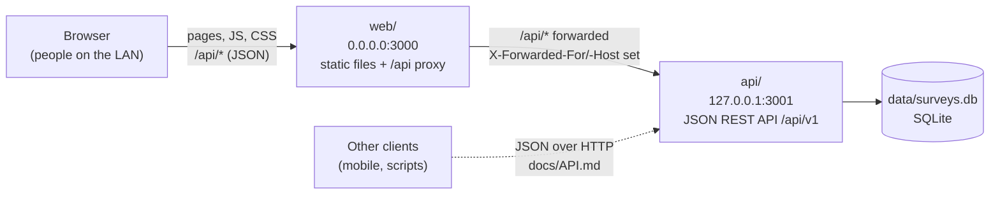

# Sharevy

Self-hosted app to create surveys and collect responses through a shareable link.

- **Creators** have accounts (email + password) and manage their own surveys.
- **Respondents** answer through the link: no account, and anonymous unless they choose to leave their name.
- **Two parts that only talk JSON:** a REST API (`api/`) and a browser client (`web/`). Any other client (a mobile app, a script) can use the same API.
- **Small footprint:** Node.js with its built-in SQLite, one pinned npm dependency in the API ([`qrcode`](https://www.npmjs.com/package/qrcode)) and none in the web client. After `npm install`, everything works offline inside a private network.

## Architecture



| Part | Folder | Listens on | Role |
|------|--------|-----------|------|
| REST API | `api/` | `127.0.0.1:3001` (recommended) | Business rules, database, accounts, CSV, QR codes, live update streams. JSON only, no HTML. Contract: [docs/API.md](docs/API.md) |
| Web client | `web/` | `0.0.0.0:3000` | A zero-dependency server that sends the single-page app (plain JavaScript ES modules, no build step) and forwards `/api/*` to the API |

The browser only ever talks to the web server, so it sees **one origin**: no CORS for the web client, and share links on the LAN keep working with the same address as before (`http://<server-ip>:3000`). The API stays on localhost, reachable only through that proxy.

## Requirements

- Node.js **22.13+** (uses the built-in `node:sqlite` module).
- Internet once, for `npm install` inside `api/` (or copy `api/node_modules` from another machine). The web client has no dependencies.

## Run

Quick path, from the repository root:

```bash
npm --prefix api install   # once: installs qrcode inside api/
npm run start:api          # terminal 1: API on port 3001
npm run start:web          # terminal 2: web client on port 3000
```

1. Open `http://localhost:3000`, register a creator account, and create a survey.
2. Other people on the same network open the share link shown on the survey page (`http://<server-ip>:3000/s/<token>`).

By default the API listens on `127.0.0.1` and trusts the `X-Forwarded-For` header the web proxy sets, so its rate limits count each person. Share links and QR codes use the address the browser opened (for example `http://<server-ip>:3000`); to pin one address instead, set `WEB_BASE_URL`:

```bash
WEB_BASE_URL=http://<server-ip>:3000 npm run start:api
```

| Root script | What it does |
|-------------|--------------|
| `npm start` | Same as `npm run start:api` |
| `npm run start:api` | Starts the API (`api/src/server.js`) |
| `npm run start:web` | Starts the web client (`web/server.js`) |
| `npm test` | API tests, then web tests |
| `npm run test:api` / `npm run test:web` | One package only |
| `npm run create-user -- <email> <name> <password>` | Creates a creator account in the database (useful when registration is disabled) |

### Desktop control script (Windows)

The operator's `Sharevy server.bat` (kept on the desktop, outside this repository) starts, stops, restarts and reports the status of both parts, from a menu or as `"Sharevy server.bat" start|stop|restart|status`. It detects the server's LAN IP and runs:

| Process | Settings it applies |
|---------|---------------------|
| API | `PORT=3001`, `HOST=127.0.0.1`, `TRUST_PROXY=true`, `WEB_BASE_URL=http://<lan-ip>:3000`, `CORS_ORIGINS=http://<lan-ip>:3000,http://localhost:3000` |
| Web | `PORT=3000`, `HOST=0.0.0.0`, `API_URL=http://127.0.0.1:3001` |

Both run hidden in the background and log to `data/*.log`. Overrides: `SHAREVY_DIR`, `SHAREVY_WEB_PORT`, `SHAREVY_API_PORT`.

### Docker

One command builds the image and starts both processes:

```bash
docker compose up -d --build
```

Open `http://<this machine's IP>:3000`. The image is `node:26.13.1-alpine` (the smallest official
Node image, same Node version as the tests) with npm removed; `compose.yml` runs it twice: `api`
(not published, reachable only by `web`) and `web` (port `3000`, or `SHAREVY_PORT`). Data lives in
the `sharevy-data` volume, so rebuilding or updating never touches it.

| Task | Command |
|------|---------|
| Logs | `docker compose logs -f` |
| Stop | `docker compose down` (keeps the data volume) |
| Update after `git pull` | `docker compose up -d --build` |
| Create a creator account | `docker compose exec api node api/scripts/create-user.js <email> <name> <password>` |
| Bring an existing database | Stop the old server first (so the file is complete), then: `docker compose stop api`, `docker compose cp data/surveys.db api:/data/surveys.db`, `docker compose run --rm -u root api chown node:node /data/surveys.db`, `docker compose start api` |
| Back up the database | `docker compose cp api:/data/surveys.db ./surveys-backup.db` |

Settings: `SHAREVY_PORT`, `ALLOW_REGISTRATION` and `WEB_BASE_URL` can be set in the shell or in a
`.env` file next to `compose.yml`. The API logs a warning about `TRUST_PROXY` on a non-loopback
host: in Docker its port is not published, so only the web container can reach it.

## Configuration (environment variables)

**API** (`api/src/config.js`)

| Variable | Default | Description |
|----------|---------|-------------|
| `PORT` | `3001` | HTTP port. |
| `HOST` | `127.0.0.1` | Interface to bind. The default keeps the API reachable only through the web proxy. To expose it to other clients, set `HOST=0.0.0.0` (then `TRUST_PROXY` defaults to `false`). |
| `DB_PATH` | `data/surveys.db` | SQLite file. Relative paths are resolved from the repository root. Back this file up. |
| `WEB_BASE_URL` | unset | Address of the web client; share links and QR codes point to `<WEB_BASE_URL>/s/<token>`. Unset, they use the address the browser opened (the web proxy's `X-Forwarded-Host`, only with `TRUST_PROXY`), else `http://localhost:3000`. Set it to pin one address (e.g. `http://192.168.1.20:3000`). `BASE_URL` is read as a fallback. |
| `CORS_ORIGINS` | `http://localhost:3000` | Comma-separated browser origins allowed to call the API directly; `*` allows any. Not needed for the web client, which goes through its proxy. |
| `ALLOW_REGISTRATION` | `true` | `false` disables self-registration of creators (use `npm run create-user`). |
| `TRUST_PROXY` | `true` on a loopback `HOST`, else `false` | `true` reads the client IP from `X-Forwarded-For`, which the web proxy always overwrites. An explicit value always wins; never set `true` on an API reachable directly (see [Security notes](#security-notes)). |
| `LOGIN_MAX_FAILURES` | `10` | Failed logins allowed per email + IP every 15 minutes before answering 429. |
| `SUBMISSION_LIMIT` | `60` | Responses accepted per survey + IP every 10 minutes (`0` disables). Raise it if many people answer from one shared PC. |
| `FUN` | unset | `true`, `1`, `yes` or `on`: the admin panel's login (`/..command/`) greets with "You shouldn't be here, but if you know what you're doing..." (Spanish: "No deberías estar aquí, pero si sabes lo que haces...") instead of the plain line. Set it on the API service. |

**Web client** (`web/server.js`)

| Variable | Default | Description |
|----------|---------|-------------|
| `PORT` | `3000` | HTTP port people open. |
| `HOST` | `0.0.0.0` | Interface to bind (all interfaces, so the LAN can reach it). |
| `API_URL` | `http://127.0.0.1:3001` | Where the API runs; `/api/*` is forwarded there (`http` or `https`). |

## Features

- Question types: short text, long text, number, scale (slider), email, date, dropdown, single choice, yes/no, multiple choice. Each can be required. A scale goes from 1 to 10 unless the creator picks another range (for example 1 to 5); respondents move a slider, and an untouched slider counts as no answer. Yes/no needs no options: respondents see "Yes" and "No" in their language, and results show them in yours.
- Respondents can optionally leave their name; otherwise the response is anonymous.
- Number questions accept only numbers: letters and symbols cannot be typed or pasted, and a decimal comma becomes a point.
- Answers are checked in the browser before sending, with the same rules and messages as the API: mistakes show next to each question at once. The API checks everything again.
- One response per device and survey (a random device id kept in the browser; clearing site data or another browser counts as a new device).
- Edit questions at any time; existing answers are kept.
- Questions and the options of one question must all be different (ignoring case and spaces). The editor warns while you type and will not save until they are; the API checks it again.
- Every survey has a closing date (picked with a calendar; 10 days from creation by default). It accepts answers until the end of that day, server time.
- Open/close a survey manually at any time.
- Results update live while you watch: new answers appear without reloading the page.
- Public results (off by default): the creator can turn on a results link so people without an account see the same results page, read-only, including every answer and respondent names. Turning it off makes the link stop working; turning it on again creates a new link.
- Results page with key figures (responses, named vs anonymous, last response, days left), charts for choice questions (a donut for single choice, bars for multiple choice) and a histogram with the average and median for scale questions, the full results table, and deleting individual responses.
- Phone-first layout; on wide screens (1100px and up) pages use two columns: results next to a sticky share panel, questions next to the survey settings.
- Light and dark theme (follows the device setting until changed with the theme button).
- Corporate look: IBM Plex Sans, square corners and a muted slate palette, with WCAG AA text contrast in both themes.
- Short, sober animations (page fades, a light entrance for cards and charts, a check mark that draws itself after answering); turned off when the device asks for reduced motion.
- English, Spanish and Portuguese (Brazil) interface, chosen from the language menu next to the theme button (see [Languages](#languages)).
- QR code of the share link on every survey, downloadable as PNG to print or send.
- Admin panel at `/..command/` (see [Admin panel](#admin-panel)): one master password per instance; manage every user (edit name and email, change password, delete) and their surveys (edit, close/reopen, delete).
- Survey templates: "Export as template" on a survey saves its questions (title, description, questions, required name; no answers, links or dates) as `<title>.sharevy.json`. "Import template" on My surveys opens a new survey already filled with them, to review and choose the closing date before creating it.
- CSV export: one button; the file is named after the survey and uses `;` only when some number answer has decimals (`,` otherwise). UTF-8 with BOM, headers in the creator's interface language, times in the viewer's time zone.

## Admin panel

`/..command/` is the instance's admin panel. Nothing links to it: type the address.

- **First visit:** the page asks to create the **master password** (12 to 200 characters). There is only one per instance, and **the first person to open the page creates it**. On a public server (Railway...), open it right after deploying.
- **Then:** the page asks for that password. Inside, the left column shows every user as a small card (a drop-down menu edits their name, email and password; delete removes them with all their surveys); click one to see their surveys on the right (edit, open the form, close/reopen, delete).
- **Admin sessions** last 8 hours and only for that browser tab. "Leave the panel" ends them.
- **Changing or recovering the master password** is not possible from the web, on purpose. Delete it in the database; the next visit to `/..command/` creates a new one, and every open admin session ends:

  ```sh
  # On the server, from the repository folder (Node is already there; use your DB_PATH):
  node -e "new (require('node:sqlite').DatabaseSync)('data/surveys.db').exec('DELETE FROM admin')"
  # Or with the sqlite3 tool:
  sqlite3 data/surveys.db "DELETE FROM admin;"
  ```

  With Docker, run the same `node -e` line inside the API container (`docker compose exec api ...`) with `/data/surveys.db`; on Railway, from the API service's shell, with its `DB_PATH`.

## Languages

The interface is available in **English**, **Spanish** and **Portuguese** (Brazilian), on creator and respondent pages.

| Who decides | How |
|-------------|-----|
| 1. The visitor's choice | The language menu (globe icon + current code) next to the theme button. It lists every language by its own name, switches without reloading, and is remembered in the browser (`localStorage`, key `sharevy-lang`). |
| 2. The browser | Otherwise, the first supported language in the browser's language list (`es-MX`, `es-ES`… all count as Spanish). |
| 3. Default | English. |

Surveys themselves (titles, questions, options) are shown exactly as their creator wrote them.

| Texts | Live in |
|-------|---------|
| Everything the interface shows | `web/locales/en.json`, `web/locales/es.json`, `web/locales/pt.json` |
| What the API writes for people (CSV headers, yes/no in CSV, English error messages) | `api/locales/en.json`, `api/locales/es.json`, `api/locales/pt.json` |

The API sends stable error **codes**; the client translates them. To add a language, see "Add a language" in [CODE_GUIDE.md](CODE_GUIDE.md#7-common-changes-where-to-touch).

## Security notes

| Topic | How |
|-------|-----|
| Passwords | Hashed with scrypt (random salt). Login timing is the same whether or not the email exists. |
| Sessions | `Authorization: Bearer <token>`. The API stores only the SHA-256 of each token; tokens last 7 days and "Log out" ends them on the server. |
| Token in the browser | Kept in `localStorage` (`sharevy-token`), so any script on this origin could read it. Kept small on purpose: the CSP allows only this origin's scripts, the page loads no third-party code, and the DOM is built without `innerHTML`. |
| Content-Security-Policy | Strict on every web page (only this origin's scripts and styles, nothing inline); the API answers `default-src 'none'`. Plus `nosniff`, `X-Frame-Options: DENY`, `no-referrer`. |
| Network exposure | The API binds to `127.0.0.1`; only the web proxy reaches it. The proxy always overwrites `X-Forwarded-For` with the address it really sees (and `X-Forwarded-Host`/`-Proto` with the address the browser used, for share links), so the API (on a loopback host `TRUST_PROXY` is on by default) counts each person in its rate limits, not the proxy. Never set `TRUST_PROXY=true` on an API reachable directly: clients could fake their IP. |
| Rate limits | Failed logins per email + IP, and submissions per survey + IP, counted in memory (reset on restart). Answers 429 with `Retry-After`. |
| Ownership | Creators only see their own surveys; another creator's survey answers 404, like a missing one. Ownership is also enforced in SQL. |
| Share links | 144-bit random tokens; anyone holding the link can answer. |
| One response per device | The client sends a random id in `X-Device-Id`; the API stores only its hash, with a unique index per survey. It stops accidental and casual duplicates, not determined abuse. |
| CSV | Formula injection (`= + - @`) is neutralized. |
| Admin panel | One master password per instance (scrypt), created by the first visit to `/..command/` and replaced only by deleting it in the database. Admin tokens are separate from creator tokens (neither opens the other's endpoints), last 8 hours, live in `sessionStorage`, and end when the master password is deleted. Failed admin logins are limited per IP. |

## Tests

```bash
npm test
```

Runs the API suites (`api/test/`, `node:test`, in-memory database) and then the web suites (`web/test/`: the web server with a stub API, and the pure client modules).

## Building other clients

Everything the web client does goes through the documented API, so a new client (mobile, desktop, a script) needs no server change:

1. Read [docs/API.md](docs/API.md): endpoints, request/response examples, error codes.
2. Call `GET /api/v1/meta` at start-up for the rules (question types, limits, default closing days, the server's date, device id format) instead of hard-coding them.
3. Call the API through the web server's `/api` proxy, or directly: to expose the API to other clients set `HOST=0.0.0.0` (then `TRUST_PROXY` defaults to `false`), and add your origin to `CORS_ORIGINS` if it runs in a browser on another origin.

## Project structure

```
api/                    REST API (package "sharevy-api", depends on qrcode)
  src/
    server.js           entry point (config, database, HTTP server)
    app.js              router, Bearer sessions, CORS, security headers, JSON errors
    config.js           environment variables -> config
    db.js               SQLite schema + additive migrations
    routes/             meta, auth (creators), surveys (creator endpoints), public (respondents), results (public results)
    surveys.js          domain rules: survey definition, answer validation, summary, CSV
    repo.js             SQLite queries
    errors.js           error codes and the JSON error shape
    i18n.js, live.js, qr.js, rate-limit.js, auth.js, http.js
  locales/              en.json, es.json (CSV headers, yes/no, English error messages)
  scripts/create-user.js
  test/                 node:test suites
web/                    browser client (package "sharevy-web", no dependencies)
  server.js             entry point (PORT, HOST, API_URL)
  server/app.js         static files, single-page fallback, /api proxy, CSP
  index.html            the one HTML page
  locales/              en.json, es.json (all interface text)
  public/
    js/                 ES modules: app shell, router, API client, pages/, components/
    style.css, theme.js, logo.png, favicon.svg
    fonts/              IBM Plex Sans (woff2, latin subset) + its license
  test/                 node:test suites
docs/API.md             the REST API contract
assets/                 logo-source.png (full-size original of the header logo)
data/                   surveys.db and logs (not in git)
```

## Font and license

The interface uses **IBM Plex Sans** (weights 400, 500, 600; latin subset, which covers English, Spanish and Portuguese), served from `web/public/fonts/`. No request leaves the server, so it works offline in a private network.

| Item | Detail |
|------|--------|
| Source | [`@fontsource/ibm-plex-sans`](https://www.npmjs.com/package/@fontsource/ibm-plex-sans) 5.3.0, files copied in (not an npm dependency) |
| License | SIL Open Font License 1.1, see [`web/public/fonts/LICENSE-IBM-Plex.txt`](web/public/fonts/LICENSE-IBM-Plex.txt) |
| Fallback | `"Segoe UI", system-ui, sans-serif` while the font loads (`font-display: swap`) |

## Code guide

See [CODE_GUIDE.md](CODE_GUIDE.md) for a file-by-file explanation of `api/` and `web/`, and [web/README.md](web/README.md) for the web client's serving rules and tradeoffs.
